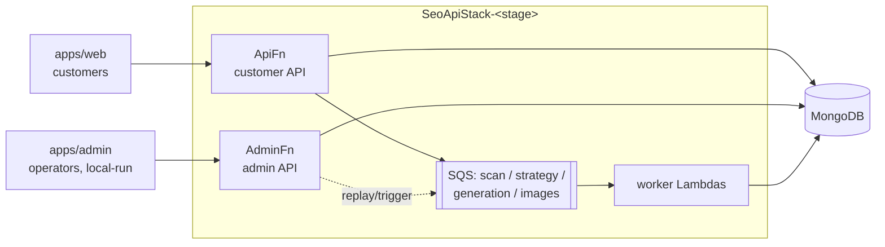

# Admin Panel (wizard-of-oz operations)

Design for the internal operator panel. While the automated SEO pipeline is still
low-quality, our own team manually manages customer accounts behind the curtain —
curating keywords, editing articles, tuning presets, comping plans, publishing — so the
product feels good before the automation is. The panel is the tool that makes that
operable: capable, safe, and built on the existing architecture (typed-client chain,
`@shared/db` repositories, `@shared/schemas`) rather than a parallel data path.

The codebase already anticipates this model: the `expert` plan is documented as
"human-operator assistance" (`hasExpert`, `org.ts`), and `db set-plan` is a manual
entitlement override. The panel productizes those seams and adds the missing ones.

Status: **design only — nothing here is built.** Grounded in the dev branch as of
2026-07-24, verified against the code (see §0).

---

## 0. Audit verification notes

This design started from a prior mutation-surface audit. Its claims were re-verified
against the code; the map is accurate, with these sharpenings/corrections:

1. **`published` article status — confirmed never written, consequence is worse than
   stated.** `dashboard.ts` only *filters* on `status: 'published'`
   (`/articles/best`, `/articles/published`); WordPress publish sets only
   `wordpress_post_id` — `status` stays `generated` and `published_at` stays `null`
   forever. So the Home "Published" count and Best Articles title-matching are
   permanently empty **even for customers who have published**. This is a product bug
   independent of the panel (needs its own issue); the panel should not paper over it
   with a manual "mark published" lever — fix the publish route to stamp
   `status`/`published_at`.
2. **Failed keywords do auto-retry** — the audit implied they're stuck. The daily
   scheduler re-enqueues `failed` entries and `claimGeneration` claims from `failed`,
   up to `MAX_GENERATION_ATTEMPTS = 3`. What's genuinely missing is (a) an immediate
   "retry now" (today you wait for the next 07:00 UTC run) and (b) *any* lever once
   attempts ≥ 3 — `listDueForGeneration` excludes those forever.
3. **Strategy re-run needs more than `claimStrategy`.** `claimStrategy` only claims
   from `none|failed`, *and* the strategy worker independently skips when
   `strategy_status === 'completed'`. Re-running a completed strategy therefore needs
   an explicit status reset first (§7).
4. **Keyword/candidate routes ARE owner-restricted** — every one goes through
   `loadOwnedOrg`/`loadOwnedPaidOrg`. The audit's "paid-gated only" phrasing was off;
   its conclusion (they're customer-facing, reusable logic) stands.
5. **Fabricating a Subscription row for comped plans is not just unwise, it's blocked
   and counterproductive.** `SubscriptionSchema.provider` is the enum
   `['lemonsqueezy']` (schema change required), and the portal route passes
   `provider_customer_id` to the LemonSqueezy API — a fake id turns today's clean 404
   into a provider error. Recommendation in §6: don't fabricate; leave `db set-plan`
   semantics and track the portal-messaging gap separately.
6. Confirmed as stated: `CandidateRepo.setStatus` is dead code (`candidate.repo.ts:139`);
   `hasExpert` is called nowhere outside its test; `wordpress_token` is stored
   plaintext (vs. the AES-256-GCM GSC token); no entity anywhere has provenance
   (who/what wrote this); the CLI's only identity is "whoever has `MONGODB_URI`".

---

## 1. Goal & non-goals

### Goal

Let 1–3 trusted operators run every customer account end-to-end without touching Mongo
or the CLI: find an account, see its full state, fix its plan, curate its keyword plan,
edit its articles, trigger/retry the pipeline, and publish — with every action
attributed and logged, and invisible to the customer (operator output is
indistinguishable from product output).

### Exit condition — when does manual work retire?

Wizard-of-oz is a phase, not a destination. The audit log (§8) doubles as the
measurement instrument: **automation is "good enough" when `admin_actions` volume per
active paid org trends to ~zero for content-quality actions** — article edits per
generated article, keyword replacements per 30-day plan, manual generation retries.
Per-action-type counts also tell us *which* pipeline stage to improve next (if 80% of
actions are article content edits, generation quality is the bottleneck). The panel
then degrades gracefully into a support/debugging tool — the unstick levers and plan
override stay useful forever.

### Non-goals

- **No customer-visible features.** Nothing the customer sees changes; no
  "created by our team" badges (unlike Outrank's `created_by_super_admin`, which they
  use to *hide* admin entries — our point is the opposite: operator work must look
  exactly like product output). Provenance lives in the audit log only.
- **No raw document editor.** All writes go through repositories and their guards —
  never a generic "edit this Mongo doc" surface. Where a guard blocks a legitimate
  operator need, we add a *new, narrowly-guarded* repo method (§6), not a bypass.
- **No customer impersonation.** The panel never mints customer JWTs or calls
  customer routes on a customer's behalf (§4).
- **No billing mutations** beyond the plan override that already exists
  (`db set-plan` semantics). Subscriptions stay webhook-owned.
- **Not fixing adjacent product bugs in-scope** (plaintext `wordpress_token`,
  never-set `published` status) — flagged for their own issues; the panel is designed
  to inherit the fixes, not to depend on them.
- **No multi-role RBAC, approval workflows, or SSO** (v0 — see §4 for what's reserved).

---

## 2. Operating model

Operators are the two-person team (backend + frontend maintainer) — the same humans
wearing two hats. Personas describe the *jobs*, not different people:

**Content operator** — the daily curtain work on paid/`expert` orgs:

- Morning sweep: which orgs have failed generations, empty upcoming planner days, or
  articles awaiting review? (MVP: per-org after search; a cross-org "needs attention"
  queue is phase 2.)
- Curate the plan: research keywords for the org's niche, add good ones to the pool,
  schedule/reschedule/replace weak planner entries before they generate.
- Review each generated article; rewrite weak sections in the editor; fix
  title/meta/slug; then publish to the customer's WordPress.
- Retry a failed generation *now* rather than waiting for tomorrow's 07:00 UTC run.

**Account operator** — episodic account surgery:

- Onboard a hand-held customer: set their plan (`expert`), kick the strategy job,
  tune presets (business description, audience, competitors, article preferences) so
  generation output fits the customer's voice.
- Unstick: a scan that died mid-onboarding, a strategy job that failed, a keyword
  over the attempt cap, a broken WordPress connection.
- Diagnose: view the org exactly as the system sees it — statuses, plan,
  subscription, GSC/WordPress connection health, audit history.

Both jobs share one interaction shape: **search for an org → org detail workspace →
act**. That shape drives the whole API surface (§9).

---

## 3. Architecture & placement

### The decision

Three candidate placements, weighed on isolation vs. reuse:

| Option | Reuse | Isolation | Cost |
| --- | --- | --- | --- |
| (a) Admin routes inside the customer API Lambda (`/api/v0/admin/*`) | Everything free | Weakest: admin code + admin secret in the customer-serving bundle; one middleware bug exposes admin routes on the public customer URL; admin routes appear in the public OpenAPI spec | Lowest |
| (b) **Admin router in `apps/api`, deployed as its own Lambda + own HTTP API** | Same repos/services/clients, same package, same stack, same bundling | Strong: separate URL, separate secret, separate bundle — customer Lambda contains zero admin code and vice versa | ~1 `NodejsFunction` + 1 `HttpApi` in CDK |
| (c) Standalone service/app with its own data access | None — duplicates the repo layer and its invariants | Strongest | Highest, and violates "no parallel data access" |

**Recommendation: (b).** It keeps the audit's two competing goods: full reuse of
`@shared/db` / `@shared/schemas` / the API's SQS + WordPress clients, and a hard trust
boundary. The repo already practices per-function secret scoping ("only the API Lambda
is granted the JWT secret — never the worker"); (b) extends that: the admin Lambda
gets the *admin* secret, the customer Lambda never does, and neither can validate the
other's tokens. (a) is rejected because the blast radius of a middleware mistake is
the entire customer base; (c) because it rebuilds the conditional-update invariants
the repos already encode.

### Shape



- **Admin API**: new subtree `apps/api/src/admin/` — its own `OpenAPIHono` app
  mounted at `/admin/v0/*`, exporting `AdminAppType` (same chained-`.openapi()`
  pattern as `routes/index.ts`), with its own `openapi.json` + Swagger UI served only
  by the admin Lambda. New Lambda entrypoint (e.g. `src/admin-index.ts`) bundled by
  the same CDK Style-A `NodejsFunction`; its own `HttpApi` in the existing per-stage
  stack. Local dev: the api `dev.ts` also serves the admin app on a second port
  (:8788), same pattern as :8787.
- **Typed client**: `packages/shared/clients/src/client.admin.ts` wrapping
  `hc<AdminAppType>` — a sibling of `client.api.ts`, same zero-codegen chain.
- **Admin UI**: new thin workspace `apps/admin` (Vite + React SPA — an internal
  operator tool needs no SSR, and none of `apps/web`'s i18n/marketing baggage) on
  the admin typed client. **Not** a route group in `apps/web`: operators aren't
  customers, the app must never ship in the customer bundle, and — usefully — customer
  frontend hosting is itself still blocked (#35), so for MVP `apps/admin` is
  **run locally** (`npm run dev -w admin`) against the staging/prod admin API URL.
  That keeps the UI off the public internet entirely with zero hosting work. Hosting
  it later is an open question (§11).

---

## 4. Auth & security model

### Why not the customer auth stack

The customer JWT carries `{ sub: userId, email }` — no role — and every protected
route re-derives authorization via `loadOwnedOrg`'s hard `org.user_id === userId`
check. That check is load-bearing customer isolation, repeated in every handler.
Teaching it about admin tokens means either a second code path through every handler
or a role check every future route must remember — an easy place to regress isolation.
Operators also aren't rows in the `users` collection and shouldn't be. Separate
system, full stop.

### The scheme (v0)

- **Identity**: Google sign-in, reusing `verifyGoogleIdToken` (`clients/google.ts`) —
  the ID token is just proof of "this Google account", same `GOOGLE_CLIENT_ID`
  audience. We do *not* use a Workspace-domain (`hd`) gate: the team uses personal
  Gmail accounts, so there is no common domain to gate on.
- **Authorization**: the verified email is checked against a fixed **operator
  allowlist** — an SSM parameter (`/seo/<stage>/admin/operators`, comma-separated
  emails; plain env var locally). No `admins` collection: two operators don't need a
  CRUD surface, and the allowlist lives with the other per-stage config. Not on the
  list ⇒ 403, logged.
- **Session**: `POST /admin/v0/login` signs an **admin JWT with a separate HS256
  secret** (`ADMIN_JWT_SECRET_PARAM`, an SSM SecureString granted *only* to the admin
  Lambda), claims `{ sub: email, email, role: 'operator' }`, TTL ~12h.
  `adminAuthMiddleware` verifies it and sets `c.var.adminAuth = { email, role }`.
- **Fail-closed wiring**: unlike the customer app's per-route middleware declaration,
  the admin app applies `adminAuthMiddleware` globally on the router (everything
  except `/login`), so a forgotten declaration on a new route fails closed, not open.
  This is a deliberate deviation from the per-route convention, for exactly one app.

### Role model

**Single role (`operator`) for v0.** Two operators, both founders — tiering
(viewer/support/superadmin) is speculative today and CLAUDE.md says don't build it.
The token *carries* a `role` claim from day one so adding tiers later is additive
(new claim values + per-route checks), not a token-shape migration.

### Threat model

The panel reads/writes every customer's data and can publish to customers' production
WordPress sites. Assets, adversaries, mitigations:

| Threat | Mitigation |
| --- | --- |
| Stolen operator Google account / admin JWT | Allowlist is small + auditable; 12h TTL; Google account security (2FA) is the real perimeter — acceptable for an internal tool; every action attributed in the audit log so compromise is detectable |
| Customer token used against admin routes (or vice versa) | Different signing secrets — cross-validation is cryptographically impossible; different URLs |
| Admin code/secret exposure via the customer surface | Separate Lambda bundle and HTTP API; customer Lambda has no admin code, no admin secret, no admin routes in its OpenAPI spec |
| Confused-deputy bug (new admin route forgets auth) | Router-global middleware (fail closed) |
| Secret/token exfiltration through admin *reads* | Response DTO mappers only (the `toArticleDetail` pattern) — never return raw entities. `wordpress_token` → `{ connected, connected_at }`; `refresh_token_enc` never returned; the admin Lambda is **not granted** `GSC_TOKEN_KEY_PARAM`, the customer JWT secret, or the Google client secret at all (least privilege — it can't decrypt what it can't read) |
| Insider misuse | Append-only audit log (§8): insert+list repo only, no update/delete methods; both operators can read it |
| Wrong-environment mistakes (the CLI's "applies to whatever `MONGODB_URI` targets" footgun) | The admin *URL* determines the environment — no ambient config. UI shows a persistent stage banner (staging/prod) derived from the URL it's pointed at |
| Network exposure | v0: auth only (the unhosted local UI is convenience, not security). API Gateway IP allowlisting / WAF is a phase-3 hardening, listed in §11 |

---

## 5. On-behalf-of mutation model, audit trail & guardrails

### On-behalf-of

Every admin route takes an **explicit org context** (`org_id` in path/body — same
shape as the customer API) and loads the org directly (`OrgRepo.findById`), skipping
the ownership check *in the admin handler only*. `loadOwnedOrg` and every customer
route are untouched. No impersonation: the panel never signs a customer JWT and never
calls customer HTTP routes — reuse happens at the repo/service layer (§6), so the
trust boundary stays a boundary.

### Audit trail

One new append-only collection, `admin_actions` (schema in §8). A small `audit()`
helper is called in each admin handler **after** a successful mutation:

- `actor` (operator email from `c.var.adminAuth`), `action`
  (`'org.set_plan'`, `'keyword.reschedule'`, `'article.update_content'`, …), `org_id`,
  `entity { type, id }`, `payload` (the request body), `before` (the pre-mutation
  entity snapshot — the handler already loaded it, so this is free), `at`.
- Successful mutations only; refused guards (409s) and errors are already in
  CloudWatch via the request logger. Reads are not logged (v0 — revisit if the
  team grows).
- **Reversibility = the `before` image.** No automated undo in v0 (speculative);
  the snapshot makes any manual revert a copy-paste, and the log makes "what changed
  on this org last Tuesday" answerable. Explicit call, not middleware magic —
  matches the codebase's explicit style, and lets each handler choose what `before`
  means for it.
- If the audit insert fails after a successful mutation, log loudly and return the
  mutation's success anyway — no transactions in this codebase, and losing one audit
  row beats un-reverting a customer-visible change. Accepted for an internal tool.

**Why not per-entity provenance stamps** (the `created_by_super_admin` analog): our
requirement is "invisible to the customer, auditable to us." A separate log satisfies
auditability without touching any entity schema, any customer read path, or any
serializer. Entity stamps become worth it only if a *runtime* behavior must branch on
provenance (none does today); revisit then.

### Guardrails

- **Two-step confirm in the UI** for anything destructive or customer-visible:
  unschedule/reject, plan change, strategy force-rerun, scan re-run, WordPress
  publish/update ("this posts to the customer's live site").
- **API-level refusals for the truly dangerous**, not just UI confirms: scan re-run is
  refused outright for `setup_complete` orgs (§7); presets PATCH refused when the org
  has no presets; all existing repo guards (terminal statuses, claim races,
  unique-index conflicts) stay in force and map to 409s exactly like the customer API.
- **Customer-facing side-effect inventory** (what an operator action can make a
  customer see): WordPress posts on their site (publish/update), plan changes
  (their UI capabilities change), strategy/generation runs (planner/articles appear).
  There is **no email sending anywhere in the product today**, so "accidental email"
  is a non-risk until email exists. The UI labels these actions distinctly.
- **Staging vs. prod**: the admin stack deploys per stage like everything else
  (`SeoApiStack-staging` first; prod rides the existing deferred prod story, #43).
  The stage banner (§4) is the operator-facing guard.
- **Don't fight the images worker**: article content edits while
  `images_status: 'pending'` can be clobbered by `fillImageSlot`'s atomic content
  swap. The admin editor shows `images_status` and warns (or soft-blocks) editing
  until it's `complete`/`failed` (§7).

---

## 6. Capability surface

Per entity: what an operator can view/mutate, and whether it's reuse or new surface.
"Reuse" always means *repo/service layer* reuse inside thin admin handlers — never
calling customer routes over HTTP.

| Entity | View | Mutate | Mechanism | New surface needed |
| --- | --- | --- | --- | --- |
| **Org** | Full detail (statuses, plan, presets, domain rating, onboarding meta; `wordpress_token` redacted to `{connected, connected_at}`) | Plan override (with strategy kick, `set-plan` semantics); presets deep-merge edit (any status, unlike the customer's `setup_scan_completed`-only gate) | `OrgRepo.findById`, `OrgRepo.setPlan` + `claimStrategy` + `enqueueStrategyTask` (the exact sequence `apply-event.ts` and the CLI already use — a third copy; extracting a shared service is optional, note in impl PR), `mergePresets` + `OrgRepo.updatePresets` | **Org search** (`OrgRepo` has no list/search — new `search(query)` by URL substring + id, joined with `UserRepo.findByEmail`); name/`website_url`/`user_id` edits **deferred** (§11) |
| **User** | Lookup by email; their orgs | Nothing (no need identified) | `UserRepo.findByEmail`, `OrgRepo.findByUserId` | — |
| **Candidate pool** | Full paginated pool incl. `rejected` (customer UI hides nothing here either, but admin also sees `rejection_reason`, scores, SERP competitors) | Add candidates (manual research), reject, **un-reject**, schedule onto planner | `CandidateRepo.listByOrg`, `addCandidates` (source `'manual'` — no new enum value; provenance is the audit log), `rejectIfCandidate`, `scheduleCandidate` | `CandidateRepo.restoreRejected` — a *conditional* `rejected → candidate` update (one winner, same style as `rejectIfCandidate`). Supersedes the dead unconditional `setStatus`; don't expose the raw setter |
| **Keyword / planner** | Full planner incl. `generation_error`, `generation_attempts`, `generation_started_at` (customer view omits attempts/timing) | Reschedule, unschedule (releases candidate), **generate now**, **reset a spent/failed keyword**; edit brief fields (type/intent/score) | `KeywordRepo.listByOrg`, `reschedulePending`, `deleteUnstarted` + `releaseAfterUnschedule`, `enqueueGenerateTask` (worker's `claimGeneration` provides idempotency) | `KeywordRepo.resetGeneration` — conditional: `failed → pending`, zero `generation_attempts`, only while `article_id: null` (the over-cap lever, §0.2). `updateBrief` (guarded `pending` + unlinked) — phase 2 |
| **Article** | Full record incl. image slots, video, `wordpress_post_id` | Edit content (title/slug/meta/body), publish/update to WordPress, replay the image task | `ArticleRepo.listByOrg`/`findById`, `updateContent` (same validation rules as the customer editor), `submitWordPressArticle`/`editWordPressArticle` + `setWordPressPostId` (dup-guard intact), `enqueueImageTask` (per-slot set-if-absent guards make replay safe) | Single-article delete / unpublish: **deferred** — no route or repo method exists, `deleted` status is aspirational, and no operator job needs it yet |
| **Subscription** | Latest + active subs for the org (provider ids, tier, status, period end) | Nothing — webhook-owned. Comping = plan override on Org | `SubscriptionRepo.findLatestByOrg`, `listActiveByOrg` | — . Per §0.5, do **not** fabricate Subscription rows for comps; the portal-404-for-comped-orgs gap gets its own issue (§11) |
| **GSC connection** | Connection health: `google_email`, `site_url`, `connected_at`, `last_refresh_failed_at` — **never tokens** | Disconnect (unstick lever; forces clean re-onboard) — phase 2 | `GscConnectionRepo.findByOrgId`, `deleteByOrgId` | Nothing can *repair* a connection server-side — OAuth consent is the customer's; the panel shows "broken since X, ask customer to reconnect" and that's correct, not a gap |
| **Integrations (WordPress)** | Connected + when (token redacted) | Connect on behalf (wizard-of-oz engagements where we hold the customer's plugin key); disconnect — phase 2 | `testWordPressIntegration` + `OrgRepo.saveWordPressConnection` (same verify-then-save as the customer route) | `OrgRepo.clearWordPressConnection` (`$unset` token + timestamp) — phase 2 |
| **Presets** | Included in org detail | One deep-merge PATCH over the whole `SetupPresets` (business/audience/blog/article prefs in one place, vs. the customer's three scoped routes) | `mergePresets` + `OrgRepo.updatePresets` | — |
| **Pipeline jobs** | Org detail shows scan/strategy status; keyword rows show generation state | Trigger/replay — see §7 | api's `enqueueScanTask`/`enqueueStrategyTask` + worker-style `enqueueGenerateTask`/`enqueueImageTask` (admin Lambda gets send-rights on all four queues) | Strategy force-rerun status reset (§7) |

The through-line: **customer-parity actions reuse existing repos/services unchanged;
every genuinely new capability is a new *conditionally-guarded* repo method in the
existing style** — `restoreRejected`, `resetGeneration`, `search`, later
`updateBrief`/`clearWordPressConnection`. No raw-override path exists. If an operator
hits a guard that's wrong, we widen that one guard deliberately, in a PR, with a test.

---

## 7. Async pipeline interaction

The org's pipeline: scan (SQS) → strategy (SQS) → daily 07:00 UTC EventBridge
scheduler → generation (SQS) → images (SQS) → manual WordPress publish. Admin levers
per stage, leaning on the idempotency the workers already have:

- **Scan — re-run for stuck onboarding only.** `POST …/scan` re-enqueues `ScanTask`.
  Hard guard: **refused when `setup_status === 'setup_complete'`** — the worker's
  `completeScan` overwrites presets *and* resets status to `setup_scan_completed`,
  which would clobber customer/operator preset edits and knock a live org out of the
  dashboard gate. Rescanning a live org is a different (deferred) feature that must
  merge, not overwrite.
- **Strategy — run and force-rerun.** Normal run: `claimStrategy` (claims from
  `none|failed`, exactly-one-job) → `enqueueStrategyTask` — identical to
  finalize/webhook/CLI. Force-rerun of a `completed` strategy (per §0.3):
  `setStrategyStatus('failed')` → `claimStrategy` → enqueue, behind an explicit
  `force: true` + UI confirm. Safe to repeat: the pipeline dedupes against existing
  planner keywords and pool candidates, so a re-run *adds* fresh opportunities rather
  than duplicating (worst case: more candidates than needed).
- **Generation — "generate now" and the over-cap reset.** Retry-now =
  `enqueueGenerateTask({ org_id, keyword_id })` directly; the worker's atomic
  `claimGeneration` makes double-clicks, races with the daily scheduler, and
  redeliveries converge (terminal/in-flight claims are refused; stale `generating`
  >15min is reclaimable). For keywords past `MAX_GENERATION_ATTEMPTS` (3):
  `resetGeneration` first (§6), then enqueue.
  **Ordering guardrail:** the worker fails generation for unpaid orgs (consuming an
  attempt) — the UI surfaces plan prominently and warns before generating on a
  `free` org: set the plan first.
- **Images — replay.** `enqueueImageTask({ org_id, article_id })`; the worker's
  set-if-absent plan and per-slot `url: ''` guards make replay safe by design
  (see [article-images.md](article-images.md)). This is the lever for
  `images_status: 'failed'` articles (which block WordPress publish).
- **WordPress publish/update** — same client calls and dup-guard as the customer
  route (`wordpress_post_id` set-once; update requires it). Publish remains manual
  and per-article; the panel adds no auto-publish (that's #53).

**Avoiding operator-vs-automation fights.** Two real contention windows:

1. *The daily scheduler vs. plan curation.* An operator reworking tomorrow's keyword
   can lose the race with the 07:00 UTC run. v0 answer: use the existing mechanism —
   reschedule the keyword to a future date while working (the same conditional
   updates that protect customers protect operators: `reschedulePending`/
   `deleteUnstarted` refuse once generation starts, so there are no torn states —
   worst case an article generates early and the operator edits it). A per-org
   `automation_paused` flag (checked by scheduler + workers) is the clean fix but
   adds a field and three checks for a race we haven't lost yet — **phase 3 /
   open question**.
2. *The images worker vs. the article editor.* `fillImageSlot` atomically swaps
   `content` while filling a slot, so operator edits during `images_status: 'pending'`
   can be overwritten. The admin editor warns/soft-blocks until images are terminal
   (§5). Same hazard exists for customers today; the panel just respects it visibly.

---

## 8. Data model additions

Deliberately minimal — one collection, two SSM parameters, zero changes to existing
entities:

- **`admin_actions`** (new collection; `AdminActionSchema` in `@shared/schemas`,
  `AdminActionRepo` in `@shared/db` exposing only `insert` + `listByOrg`/`list` —
  append-only by construction):

  ```
  {
    id, at: Date,
    actor: string,            // operator email
    action: string,           // 'org.set_plan' | 'keyword.reschedule' | ...
    org_id: string,
    entity: { type: string, id: string } | null,
    payload: unknown,         // request body as received
    before: unknown | null    // pre-mutation entity snapshot
  }
  ```

  Indexes (via `ensureIndexes()`): `{ org_id: 1, at: -1 }`, `{ at: -1 }`. Volume is
  trivially small; keep forever.
- **SSM (per stage)**: `ADMIN_JWT_SECRET_PARAM` (SecureString, granted only to the
  admin Lambda) and the operator allowlist parameter (§4). Local dev: plain
  `ADMIN_JWT_SECRET` / `ADMIN_OPERATORS` env vars, same fallback pattern as
  `auth/secret.ts`.
- **Not added**: admin users collection (allowlist suffices), per-entity provenance
  fields (§5), `automation_paused` (§7 — deferred).

---

## 9. API surface

New module: `apps/api/src/admin/` — own `OpenAPIHono` app, `AdminAppType` export,
router-global auth middleware (§4), same `createRoute`/Zod/DTO conventions as the
customer routers. Route plan (all under `/admin/v0`, all auth'd except login):

```
POST   /login                              google id_token → admin JWT (allowlist-gated)

GET    /orgs?query=                        search: email | website_url substring | org id
GET    /orgs/{org_id}                      full workspace detail: org (redacted) + owner
                                           + subscription(s) + GSC health + counts
GET    /orgs/{org_id}/audit                the org's admin_actions, newest first

POST   /orgs/{org_id}/plan                 { plan } — set-plan semantics (strategy kick)
PATCH  /orgs/{org_id}/presets              deep-merge over full SetupPresets
POST   /orgs/{org_id}/scan                 re-enqueue scan (refused if setup_complete)
POST   /orgs/{org_id}/strategy             { force? } — run / force-rerun

POST   /orgs/{org_id}/research             { seed } — DataForSEO research (operator curation)
GET    /orgs/{org_id}/candidates           pool incl. rejected + rejection_reason
POST   /orgs/{org_id}/candidates           add to pool (source 'manual')
POST   /candidates/{id}/schedule           { scheduled_date }
POST   /candidates/{id}/restore            un-reject (conditional)            [phase 2]
DELETE /candidates/{id}                    reject (conditional)

GET    /orgs/{org_id}/planner              incl. attempts / error / started_at
PATCH  /scheduled/{id}                     reschedule
DELETE /scheduled/{id}                     unschedule (+ release candidate)
POST   /scheduled/{id}/generate            generate/retry now
POST   /scheduled/{id}/reset               resetGeneration (over-cap lever)    [phase 2]

GET    /orgs/{org_id}/articles             list (paginated)
GET    /articles/{id}                      full detail incl. image slots
PATCH  /articles/{id}                      content edit (same validation as customer editor)
POST   /articles/{id}/images               replay image task                   [phase 2]
POST   /articles/{id}/wordpress            publish (dup-guarded)
PUT    /articles/{id}/wordpress            update published post
POST   /orgs/{org_id}/integrations/wordpress   connect on behalf              [phase 2]
```

Handlers are thin: load → guard → repo/service call → `audit()` → DTO. The admin
Lambda's grants: Mongo URI param, admin secret + allowlist params, send on all four
queues; explicitly **not** the customer JWT secret, GSC token key, or Google client
secret. `GOOGLE_CLIENT_ID` (public) is shared for login verification.

Frontend (`apps/admin`): three screens — org search, org workspace (tabs: overview /
pool / planner / articles / audit), article editor. All on the admin typed client;
stage banner always visible.

---

## 10. Phasing

Ruthless MVP test: *can an operator run this week's wizard-of-oz accounts without
Mongo or the CLI?* Auth and audit are in the MVP not because they're fun but because
retrofitting attribution is how you end up with the CLI's "no notion of which teammate
ran this" — and the audit log is also the exit-condition metric (§1).

**Phase 0 — skeleton (days 1–2).** Admin Lambda + HTTP API in CDK; `/login` +
allowlist + admin JWT; `admin_actions` repo + `audit()`; org search + org detail +
`POST plan`. *Retires the most common CLI/Mongo op (set-plan) with attribution.*

**Phase 1 — content curation (rest of week 1). The MVP.** Pool + planner + articles
read; research/add/schedule/reschedule/unschedule; article content editor; generate
now; WordPress publish/update; strategy run (non-force); presets PATCH; the three
`apps/admin` screens, run locally. *An operator can fully run an `expert` account.*

**Phase 2 — unstick levers.** `resetGeneration`, `restoreRejected`, strategy
force-rerun, guarded scan re-run, image-task replay, WordPress connect-on-behalf +
disconnect, GSC disconnect, keyword `updateBrief`.

**Phase 3 — scale-out (build only when felt).** Cross-org "needs attention" queue
(failed generations / stuck scans / empty upcoming days across all orgs);
`automation_paused`; API Gateway IP allowlist/WAF; hosted admin UI; tiered roles;
undo-from-`before`.

---

## 11. Open questions & risks

Genuinely the team's call — listed, not guessed:

1. **Comped plans vs. the billing portal.** A comped `paid`/`expert` org has no
   Subscription row, so the customer's "manage billing" 404s (§0.5). Options:
   (a) live with it (comped customers have nothing to manage — arguably correct),
   (b) teach the portal route/FE a clean "no subscription" state. Recommend (a) + a
   small issue for (b)'s FE messaging. Fabricating Subscription rows is rejected
   outright (schema + provider-API reasons, §0.5).
2. **`published`/`published_at` product bug** (§0.1). Fix in the WordPress publish
   route (customer + admin both inherit)? Recommended, but it changes customer-visible
   Home counts — needs its own issue and a look at backfilling `wordpress_post_id`-set
   articles.
3. **Org surgery: rename, change `website_url`, re-parent `user_id`.** No operator
   job needs these yet, and each has real blast radius (URL feeds scan/strategy/
   WordPress; re-parenting moves a whole account across the isolation boundary).
   Deferred until a concrete case; do not build speculatively.
4. **What should `expert` actually change at runtime?** `hasExpert` is still called
   nowhere. Candidate first hook once auto-publish (#53) exists: suppress auto-publish
   for `expert` orgs so an operator reviews before anything goes live. Until then it
   remains a billing SKU + an operator convention, which is fine.
5. **Admin UI hosting.** Local-run is a feature today (nothing exposed) but couples
   operating the product to having the repo checked out. Revisit when frontend
   hosting (#35) unblocks — the admin app would want auth-independent network
   restriction if hosted.
6. **`automation_paused`** (§7): wait for the first real lost race, or preempt?
   Leaning wait — it's three extra checks and a field for a race two operators may
   never lose.
7. **Plaintext `wordpress_token`** (§0.6): should be encrypted like the GSC token
   regardless of this panel (the panel only *redacts* it). Separate issue; note the
   admin Lambda would then need the key only if connect-on-behalf lands.
8. **Prod timing.** The admin stack rides the existing staging-first flow; prod
   deploy inherits the deferred prod story (#43). Until prod exists this is moot, but
   when it lands: does the admin API ship to prod on day one, or staging-only until
   the first real customer needs curtain work?

Known risks accepted in v0: localStorage JWT in the admin UI (same posture as the
customer app, internal tool, short TTL); audit write is best-effort after mutation
(§5); no rate limiting beyond API Gateway defaults (two known callers).
