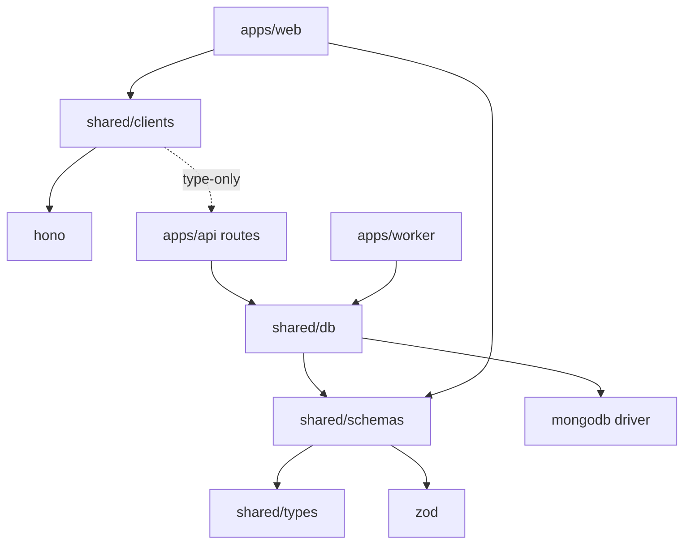

# Monorepo & Typed API Client (Hono)

Patterns adopted from the **dkn-harbor** monorepo (`/Users/fco/Documents/workspace/dkn-harbor`), adapted for this project. The goal is a single source of truth for API types so the Next.js frontend gets a fully typed, autocompleted backend client with **zero codegen** — just TypeScript inference over the Hono app type.

> **Key difference from dkn-harbor:** that project deploys to AWS **ECS** and its frontend is a *separate repo* (so its Hono client was only used service-to-service). Ours deploys the backend to **AWS Lambda behind API Gateway**, and the **frontend lives inside this monorepo** — so the frontend imports the typed client directly. That is the main win we're after.

## Workspace Layout

```
apps/
  api/                # Hono + Zod OpenAPI backend (Lambda handler)
  worker/             # Scanner worker (SQS-triggered Lambda)
  web/                # Next.js frontend (consumes @shared/clients)

packages/
  shared/
    types/            # @shared/types   — plain TS types
    schemas/          # @shared/schemas — Zod entity schemas (source of truth; depends on types + zod)
    db/               # @shared/db      — mongodb driver client + repositories (depends on schemas + mongodb)
    clients/          # @shared/clients — typed Hono RPC clients (depends on hono + api's AppType)
```

See [data-layer.md](data-layer.md) for the Zod + official `mongodb` driver pattern (no Mongoose).

### Tooling decision (locked)

This is a **Lambda-first** project, so the deploy artifact is produced by **esbuild** (via CDK `NodejsFunction`), not by a monorepo orchestrator. That drives the choices:

- **Package manager: npm workspaces.** Lambda bundling needs a flat, hoisted `node_modules`; npm provides that out of the box. pnpm's symlinked store breaks CDK `NodejsFunction` bundling unless you add `node-linker=hoisted` — not worth the footgun at this scale. (Differs from dkn-harbor, which uses Bun workspaces on ECS.)
- **No task orchestrator (yet).** CDK+esbuild owns the deploy artifact, so Turborepo would only cache CI lint/typecheck/test. Defer it; it drops in later as a single `turbo.json` with zero migration.
- **`esbuild` installed at the repo root** `package.json` — required for `NodejsFunction` bundling in a workspace.

Root `package.json`:

```jsonc
{
  "private": true,
  "workspaces": ["packages/shared/*", "apps/*"],
  "devDependencies": {
    "esbuild": "^0.x"   // required at root for CDK NodejsFunction bundling
  }
}
```

Internal deps use npm's local resolution: `"@shared/types": "*"` (npm has no `workspace:` protocol — `"*"` resolves to the in-repo package). Each shared package is tiny: `main: "src/index.ts"`, `type: "module"`, `sideEffects: false`, `exports: { ".": "./src/index.ts" }` pointing at **TS source** — esbuild inlines it into each Lambda bundle, so shared code needs **no build/publish step**. The Next.js app transpiles these workspace packages via `transpilePackages` in `next.config`. Shared lib versions are pinned normally per-package (use root `overrides` if a version ever needs forcing across the repo). TS path alias in `tsconfig.base.json`: `"@shared/*": ["packages/shared/*"]`.

Shared dependency graph (keep it acyclic):



## The Core Pattern: `AppType` → `hc<AppType>`

This is the whole trick. The backend exports the **type** of its fully-mounted router, and the client infers everything from it.

### 1. Define routes with `OpenAPIHono` and chain `.openapi()`

Each route is declared with `createRoute` (Zod request/response schemas), and routes are **chained** so the resulting type captures every endpoint. Schemas use `.openapi('Name')` so they also appear in the generated OpenAPI spec.

```typescript
// apps/api/src/schemas/setup.ts
import { z } from '@hono/zod-openapi';

export const StartScanBody = z.object({
  website_url: z.string().url().openapi({ example: 'https://example.com' }),
  org_id: z.string().openapi({ example: 'org_abc123' }),
}).strict().openapi('StartScanBody');
```

```typescript
// apps/api/src/routes/setup.ts
import { createRoute, OpenAPIHono } from '@hono/zod-openapi';
import * as schemas from '../schemas/setup';

const setup = new OpenAPIHono()
  .openapi(
    createRoute({
      tags: ['setup'],
      method: 'post',
      path: '/start_scan',
      request: { body: { content: { 'application/json': { schema: schemas.StartScanBody } }, required: true } },
      responses: { 200: { content: { 'application/json': { schema: schemas.StatusResponse } }, description: '...' } },
    }),
    async (c) => {
      const { website_url, org_id } = c.req.valid('json');
      // enqueue SQS task -> scanner worker, set status to setup_scan_in_progress
      return c.json({ status: 'setup_scan_in_progress', org_id });
    },
  );

export default setup;
```

### 2. Mount routers and export `AppType`

```typescript
// apps/api/src/routes/index.ts
import { OpenAPIHono } from '@hono/zod-openapi';
import { swaggerUI } from '@hono/swagger-ui';
import { cors } from 'hono/cors';
import setup from './setup';
import core from './core';

const app = new OpenAPIHono();
app.use('*', cors());

const routes = app
  .route(`/api/${API_VERSION}/core`, core)
  .route(`/api/${API_VERSION}/setup`, setup);

app.doc(`/api/${API_VERSION}/openapi.json`, {
  openapi: '3.0.0',
  info: { version: '0.1.0', title: 'SEO Dev API' },
});
app.get(`/api/${API_VERSION}/ui`, swaggerUI({ url: `/api/${API_VERSION}/openapi.json` }));

export default app;
export type AppType = typeof routes;   // <-- the contract the client consumes
```

### 3. Lambda entrypoint (our difference from dkn-harbor)

dkn-harbor exports a Bun server (`export default { port, fetch: app.fetch }`) because it runs on ECS. We run on Lambda behind API Gateway, so wrap the app with Hono's AWS Lambda adapter instead:

```typescript
// apps/api/src/index.ts
import { handle } from 'hono/aws-lambda';
import app from './routes';

export const handler = handle(app);
```

(For local dev we can still run the same `app` with a Node server adapter — the `app` object is the same; only the outermost adapter changes per target.)

**Bundling (Style A — CDK bundles each Lambda):** CDK's `NodejsFunction` points at this `index.ts` handler and runs esbuild at `cdk synth` time — resolving imports (including the `@shared/*` TS source), tree-shaking, and emitting one minimal `.js` per function. No separate app build step; no `dist/` to manage. Keep functions lean (the typed-client `import type` edge into `@shared/clients` is erased, so the frontend client never gets pulled into the backend bundle).

```typescript
// infra (CDK): one NodejsFunction per Lambda, esbuild bundles at synth
new NodejsFunction(this, 'ApiFn', {
  entry: 'apps/api/src/index.ts',
  handler: 'handler',
  runtime: Runtime.NODEJS_22_X,
});
```

### 4. Typed client in `@shared/clients`

The client imports the **type only** from the api app and wraps `hc`:

```typescript
// packages/shared/clients/src/client.api.ts
import { hc } from 'hono/client';
import type { AppType } from '../../../../apps/api/src/routes';

export function getApiClient(url: string, version: string) {
  return hc<AppType>(url, { fetch }).api[version]!;
}
export type { AppType as SeoApi };
```

Note the **deep relative `import type`** into `apps/api` — this is a type-only edge from `packages` → `apps`, which is fine (erased at build). It is what gives end-to-end inference.

### 5. Frontend consumes it (the main goal)

Because `apps/web` is in the same monorepo, it imports the client and gets full autocomplete + type-checked request/response bodies:

```typescript
// apps/web/lib/api.ts
import { getApiClient } from '@shared/clients';
import { getToken } from './auth';

// getToken is read per request, so the bearer header always reflects the
// latest stored JWT (attached automatically inside getApiClient).
const api = getApiClient(process.env.NEXT_PUBLIC_API_URL!, getToken);

// fully typed — body shape, response shape, and path are all checked
const res = await api.api.v0.setup.start_scan.$post({ json: { website_url } });
const data = await res.json(); // typed as StartScanResponse
```

For a header outside the route schema (e.g. a one-off bearer token), pass it via the **second** `ClientRequestOptions` arg: `api.api.v0.x.$post(args, { headers: { Authorization: ... } })`.

If a backend route's schema changes, the frontend fails to type-check — no drift, no manual client maintenance, no OpenAPI codegen step.

**Tradeoff (verified during scaffolding):** because the client imports `AppType` from the backend *source*, the frontend's `tsc` pulls the server type graph into its own compile — including modules the routes reference at runtime (`@shared/db` → `mongodb`, `process`, etc.). The web app's `tsconfig` therefore needs to be a **superset** that can compile that graph: add `"types": ["node", "react", "react-dom"]` and DOM+ESNext libs. It works and keeps zero-codegen, but couples the configs. If frontend typecheck time ever becomes a problem, the escape hatch is to emit a `.d.ts` for `AppType` from `apps/api` and import that instead (`skipLibCheck` then skips it) — at the cost of a build step. Not worth it yet.

## Testing Pattern

From dkn-harbor `apps/api/tests/routes.test.ts`. We use **Vitest** (Node runtime); the pattern maps 1:1 from dkn-harbor's `bun:test` — `vi.mock` in place of `mock.module`. Two complementary tools:

- `app.request('/path')` — raw HTTP-style calls for health/version/404/CORS.
- `testClient<AppType>(app)` from `hono/testing` — the **same typed client** as production, but bound to the in-memory app. Tests call `client.api[version]!.setup.start_scan.$post({ json: {...} })`.

Dependency injection via `vi.mock()`, hoisted **above** the app import so external clients (SQS, DB, etc.) are mocked before the module graph that reads them loads:

```typescript
import { describe, expect, test, vi } from 'vitest';

// vi.mock is hoisted to the top of the file by Vitest — runs before imports
vi.mock('../src/clients/sqs', () => ({ sqsClient: { send: vi.fn(async () => ({})) } }));

import { testClient } from 'hono/testing';
import app, { type AppType } from '../src/routes';
const client = testClient<AppType>(app);
```

(Vitest hoists `vi.mock` automatically, so the mock applies even though the import appears below it — the same "mock before the module loads" guarantee dkn-harbor gets by ordering `mock.module` calls first.)

When a test needs to **assert on the mock** (e.g. `expect(updateStatus).toHaveBeenCalledWith(...)`), define the spy with `vi.hoisted` so it's initialized alongside the hoisted `vi.mock` factory — referencing a plain `const` from the factory throws "Cannot access before initialization":

```typescript
const { updateStatus } = vi.hoisted(() => ({ updateStatus: vi.fn(async () => {}) }));
vi.mock('@shared/db', () => ({ OrgRepo: { updateStatus } }));
```

## Conventions to Carry Over

- **`OpenAPIHono` everywhere**, never plain `Hono`, so every route contributes to both the type and the OpenAPI spec.
- Routes mounted under versioned paths `/api/${API_VERSION}/<resource>`; webhooks (e.g. Stripe) mounted at root, unversioned, with signature verification instead of auth middleware.
- Zod schemas live in `apps/api/src/schemas/` with `.openapi('Name')`; export both the schema and `z.infer` type.
- Auth as Hono middleware in the `createRoute({ middleware: [...] })` array; register a `securitySchemes` component for the API key / JWT.
- Keep `@shared/clients` dependency-light (`hono` only) and `sideEffects: false` so the frontend bundles just what it uses.

## Decisions (locked)

- **Monorepo**: npm workspaces, no orchestrator yet (Turborepo deferred). `esbuild` at the repo root.
- **Lambda bundling**: Style A — CDK `NodejsFunction` bundles each function with esbuild at synth time. Shared `@shared/*` TS source is inlined; no per-app build step.
- **Runtime**: Node.js (Lambda managed runtime). Test runner is therefore Node-based (**Vitest** recommended — closest to the `bun:test` ergonomics shown above, with `vi.mock` in place of `mock.module`).
- **DB layer**: **Zod + official `mongodb` driver, no Mongoose.** Zod entity schemas in `@shared/schemas` are the single source of truth; a `@shared/db` package holds the driver client + repositories. See [data-layer.md](data-layer.md).

## Open Questions for This Project

- **API Gateway path stripping**: confirm whether the stage/base path is stripped before reaching Hono, so mounted paths line up.
- **Client base URL in the browser**: the frontend needs the public API Gateway URL at build/runtime (`NEXT_PUBLIC_API_URL`), unlike dkn's internal service-discovery URLs.

Source reference: `/Users/fco/Documents/workspace/dkn-harbor` — `packages/shared/clients/src/client.api.ts`, `apps/api/src/routes/index.ts`, `apps/api/src/routes/batch.ts`, `apps/api/tests/routes.test.ts`.
