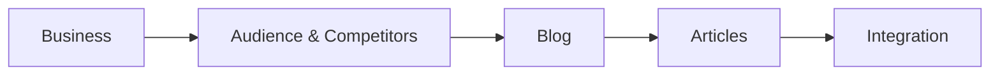

# Software Design

Lets digest the software flow first then jump to the design

This project is a dashboard design. But before landing to dashboard a new user should be landing to SETUP stage, after that it should be landing to the dashboard.

endpoint `/api/v0/core/status` returns `setup_complete` then go to dashboard, go to setup otherwise.

# Login & Subscribe

When user lands into landing page and clicks on login or subscribe he should be forwarded to google auth (or similar).

<aside>
💡

Using only google auth for login option is a good idea here in order to eliminate duplicate accounts.

</aside>

`POST: /api/v0/core/login` returns JWT.

`GET: /api/v0/core/organizations` should return the organizations the user currently have.

If no orgs are returned this is an indicator of a new/fresh user and he should be redirected to setup page.

# Setup Stage (New user onboarding)

## 1. Start

Identity is **server-owned**: the org id is the org's Mongo `_id` (exposed as a
string), per [data-layer.md](data-layer.md). The frontend does **not** mint an
`org_id` — it has none until `start_scan` creates the org and returns one, which
the FE then persists (e.g. localStorage) to poll `/status` and `/details`.

> _Resolved design tension:_ an earlier draft had the FE generate a random
> `org_id` up front. We keep server-generated ids (one identity, no client-chosen
> keys) and instead make `start_scan` **idempotent**: a retry for the same user +
> URL reuses the in-progress org rather than duplicating it (see §1 start_scan).

endpoint `/api/v0/setup/status` returns `setup_not_started` for any unknown
`org_id` (e.g. before the first scan).

Then we load the start scanning page.

**Mockup — Start (Enter URL):** A single-field landing screen headed "Let's start with **your website**!" with subtext "Share your website URL and we'll instantly gather your business information to save you time." One URL input (e.g. `https://ridersdiary.sparkie.space/`) with a **Continue** button. A validation hint appears if no URL is entered.

Enter your website URL

endpoint `/api/v0/setup/start_scan`

payload: website url string. (No `org_id` — the server creates the org and
returns its id.) Idempotent: if the user already has a non-`setup_complete` org
for this URL, that org is reused and re-armed instead of creating a new one.

this will trigger the website _scanner_worker_

enqueue task (aws sqs) which will trigger a lambda function (scanner worker)

This will also set status to `setup_scan_in_progress`

## 1.1 Scanner Worker

This will scan the website possibly scrape the data and make AI calls to generate the following presets:

- about your business details
  - business name
  - language
  - country
  - description
- Target audience & competitors
- Blog
  - sitemap url
  - main blog address
  - best article examples
- Article Preferences
  - Content & SEO
    - Article style
    - Internal links
    - Instructions for LLM
  - Engagement
    - Image style
  - And such..

All of the above are just presets, meaning user can edit and change them all. So all those forms should be behind an endpoint.

## 2. Scan Customer Website

**Mockup — Scan Website (in progress):** A loading screen with a "Scanning your website data…" spinner and an explainer card: "Let's tailor [product] to **your business**! Once we've analyzed your website, we'll guide you forward. A few important steps help us understand your business, your audience, and what great content should look like — we'll need about 5–10 minutes of your time."

scanner_worker in progress

endpoint `/api/v0/setup/status` returns `setup_scan_in_progress` .

## 3. User Input Overrides Setup Presets.

**Mockup — About your business (editable, pre-populated form):** Heading "About your business" with subtext "Based on your website, we've populated the following information, please verify and complete as needed." Fields, all pre-filled from the scan and editable:

- **Business name** (text) — e.g. `Clewas`
- **Language** (select) — e.g. `English`
- **Country** (select) — e.g. `Global (English)`, with hint "Uses US English search data as the broadest international signal."
- **Description** (rich-text) — AI-generated business summary
- **Platform and services** (continues below)

endpoint `/api/v0/setup/status` should return `setup_scan_completed`. This means setup worker is finished. And frontend can query `/api/v0/setup/details` endpoint.

`GET: /api/v0/setup/details`: returns everything (queryable) mentioned at the 1.1 making the whole setup process up until integrations a single endpoint and frontend work.

## 3.1 Integrations

This is a hard step, lets leave this for later.

**Mockup — Create Integrations:** The setup wizard is a 5-step stepper; integrations is the final step:



Heading "Create Integrations" with subtext "Connect your blog to publish articles automatically, or set this up later in your dashboard." A grid of selectable publishing-platform providers: WordPress, Notion, Webflow, Shopify, Wix, WordPress.com, API Webhook, Framer, Ghost, Next.js Blog (retrieve content through an NPM package), and Feather. This step is optional and can be deferred to the dashboard.

`GET: /api/v0/setup/integrations` Lists current Integrations

`POST: /api/v0/setup/integrations` Writes/makes Integrations

## 4. Finish Setup

Last step is finished

`POST: /api/v0/setup/finalize` will write to db.

Also sets `/api/v0/setup/status` return to `setup_complete.`

From this point forward our only concern is dashboard.

# Dashboard

**Mockup — Dashboard shell (reference: Outrank):** A left sidebar + main content layout. The sidebar groups navigation:

- **Home**
- **Articles** — Content Planner, Improvements (Beta), Content History, Articles Settings, Integrations, Linking Configuration
- **Backlink Exchange**, **Free Tools Builder**
- **Add-ons** — Human Curated Service, Get 350+ Backlinks
- Footer: referral program, upgrade prompt, account/plan info

The main area shown is the **Content Planner**: "Creating your content strategy — we're analyzing your website and competitors, selecting keywords by search volume and difficulty, and scheduling a month of articles into your planner," with an "Articles Plan: 30 per month" selector and a monthly calendar.

Outrank has many features that we wont support until much later so we can strip lots of stuff and focus on the necessary.

## 0. Reference architecture (Outrank observations)

Captured by inspecting the live outrank.so dashboard network traffic on 2026-07-01.
These are **reference notes**, not our design — ours stays a curated Hono API.

**Two API layers (theirs):**

1. `api.outrank.so/rest/v1/<table>` — **Supabase / PostgREST**. The client reads DB
   tables directly (row-level `GET`/`POST`/`PATCH`/`DELETE`, `HEAD` for counts via
   content-range). Tables seen: `organizations`, `users`, `products`, `competitors`,
   `articles`, `scheduled_keywords`, `keywords_storage`, `output_settings_presets`,
   `custom_image_presets`, `search_console_connections`, `domain_rating_history`,
   `backlink_credits`, `backlink_usage`, `seo_tools*`, and various `*_subscriptions`.
2. `www.outrank.so/api/*` — **Next.js BFF** for computed / third-party-backed data:
   `/api/subscription/status`, `/api/domain-rating`, `/api/backlinks/{count,credits}`,
   `/api/seo-tools/usage`, `/api/products/improvement-settings`, `/api/catalog/profile`,
   `/api/user/update-tracking`.

**Tenancy hierarchy (theirs):** `Organization → Product → {articles, keywords, …}`.
Almost every data call is keyed by **`product_id`** (the site); `organization_id` keys
billing/subscription. The active product is tracked in a `current_product_id` cookie. A
**product = one website**; multiple products live under one org (multi-site plans + volume
discounts).

**The `products` entity (theirs, ~50 columns — the real tenant record).** Confirms the
scan/onboarding output lives here, not on the org: `name` ("Sparkie"), `url`, `description`
(rich markdown — features/advantages/problems-solved, confirms parity-gaps G6),
`target_audiences[]` (**5 segments — an array**, confirms G3), `niche`, `sitemap_url`,
`blog_root_url`, `example_article_urls`, `status`. Plus operational flags our baseline has no
analog for: `keywords_generation_status`, `auto_keyword_generation_disabled`,
`daily_article_count` (1), `article_publishing_days`, `article_keyword_hard_mode`,
`article_improvements_{enabled,setup_completed,auto_push,publishing_days[]}`, and a whole
backlinks block (`backlinks_enabled`, `monthly_backlink_credits`, `min_backlink_domain_rating`,
`prioritize_backlinks`, `backlink_{earning,receiving}_disabled`, `link_detection_status`,
`additional_linking_sources[]`), `integration_id` / `integration_type`,
`has_human_curated_service`.

> **Divergence from ours:** our model treats an **Org as the website** (`OrgSchema`
> carries `website_url`). Outrank splits **billing tenant (org)** from **site (product)**.
> For our baseline (one site per org) this is fine; if multi-site lands, we'd introduce a
> `Product`/`Site` entity under `Org`. Recorded in
> [`onboarding-parity-gaps.md`](onboarding-parity-gaps.md) territory (deferred).

## Subscription Model

- Free
  - user behind the paywall, cant do anything except update the parameters set in setup stage.
- Paid
  - User now has access to all the features
  - first feature is articles

promo-codes: promo codes can reduce the recurring monthly fee’s or can reduce the fee’s up to certain months.

<aside>
⚠️

Promo codes need to integrate into payment system, we need to look into that. So its better to design the system with promo codes.

</aside>

### Subscription gate design (baseline)

Observed on Outrank: subscription state is read from `GET /api/subscription/status?
organizationId=…` (org-level; a `&productId=…` variant also exists for per-site add-ons).
Real response shape captured 2026-07-01:

```json
{ "isTrialSubscription": true, "status": "trialing", "cancel_at_period_end": false,
  "pauseResumesAt": null, "currentPeriodStart": 1782905128, "currentPeriodEnd": 1783164328,
  "subscriptionName": "All in One", "billingInterval": "month", "articleAddon": null }
```

Key correction to an earlier assumption: on Outrank a **trial is an entitled Stripe
subscription** (`status: "trialing"`), **not** an inert free tier. On this trial the content
engine is fully live (planner populated, keywords generated — see §2.1). For *them*
entitlement is billing-driven and there is no "free but logged in" content state — you're
either in an entitled subscription (`trialing`/`active`) or you're not. Add-ons stack on top:
`articleAddon` here, plus the `article_addon_subscriptions` and `seo_tools_subscriptions`
tables (article-volume and SEO-tools upsells billed separately from the base plan).

> **Our divergence — we DO have a free tier.** Outrank is large enough to offer nothing free
> (even their "trial" sits behind a paid subscription). Our product is **free to sign up and
> use**, with a genuine free tier as a first-class, supported state — **not** a locked-out
> shell. The paywall sits *inside* the product: **almost all real functionality (above all
> auto-generated articles, and keyword research/generation) is paid-only**, while free users
> get the full onboarding, preset/settings editing, and read-only dashboard surfaces. So for
> us `subscription_status: none` (free) is a real product experience, and the capability
> matrix below is the actual free/paid split — this is a deliberate departure from Outrank's
> no-free-tier model, not an oversight.

We mirror Outrank's *gating contract* (not its no-free-tier model, and not its table sprawl):

**Subscription state.** Store on the org: `subscription_status` ∈
`{ none, trialing, active, past_due, canceled }` + `current_period_end`. Treat
`active` (and optionally `trialing` if we offer trials) as **entitled**; everything else
is **free/locked**. Source of truth is the payment provider (Stripe) via webhook →
`OrgRepo.updateSubscription`; the API never trusts the client.

**What each tier can do:**

| Capability | Free tier (supported) | Entitled (paid) |
| --- | --- | --- |
| View dashboard, Home cards, planner shell | ✅ | ✅ |
| Edit setup presets / article settings (`PATCH /setup/presets`, `/dashboard/v0/settings/*`) | ✅ | ✅ |
| Keyword research (`POST /dashboard/v0/keywords/research`) | ⛔ paywall | ✅ |
| **Auto-generated articles** / publish workers | ⛔ paywall | ✅ |
| Integrations connect, Backlink Exchange, GSC | ⛔ (deferred anyway) | ✅ later |

The free tier is the full onboarding + settings + read-only dashboard; the paywall sits inside
the product at the value-generating actions (research, generation, publishing). "Almost
everything real is paid" — but sign-up and the setup experience are free and complete.

**Enforcement.** A small `requirePaid` middleware (composes with `authMiddleware`) checks
the caller's org `subscription_status`. Gated endpoints return **HTTP 402 Payment Required**
with a typed body `{ error: 'subscription_required', upgrade_url }` so the FE renders the
same "Upgrade to unlock" surface consistently. Read/settings endpoints skip the gate.

**Promo codes.** Model as provider-side coupons (Stripe) applied at checkout — they change
*billing amount*, not entitlement logic. Our gate only ever asks "is the subscription
`active`?", so a 100%-off promo yields a normal `active` subscription and Just Works; no
special-casing in the API. Keep promo handling entirely in the checkout/webhook layer.

**Deferred:** proration/plan-tier changes (8/30/60 articles/month), add-ons
(`article_addon_subscriptions`, premium images, SEO tools), and multi-product volume
discounts — all out of baseline.

**Observed pricing/plan model (theirs, reference — captured 2026-07-01 from the upgrade
dialogs).** Not our pricing, but useful structure:
- One headline plan **"All in One"** — **$99/mo** (crossed-out $200, i.e. a 50%-off promo),
  "growth on auto-pilot". Bundle: 30 articles/mo generated+auto-published, unlimited org users,
  auto keyword research, CMS publishing, Backlink Exchange, AI images, YouTube embeds, 150+
  languages, unlimited AI rewrites, + a "90-Day SEO Sprint" playbook.
- **Per-product (per-site) billing with volume discounts:** each product ≈ $99, dropping (e.g.
  "$89.10 each" at a "10%" volume tier). Confirms the Org(billing) → Product(site) split — each
  site is its own recurring line item under one org, discounted by count. Only relevant to us
  if/when multi-site lands (deferred).
- **Lifecycle states beyond active:** `trialing` → convert-to-paid ("End trial & upgrade —
  $99/mo"), plus **pause/resume** ("Your subscription will be paused on …"; "can't add products
  while paused… Resume to continue generating"). Full status vocabulary seen across their tables:
  `trialing, active, past_due, pausing, trial_pausing, paused, canceled`. Our baseline enum
  (`none, trialing, active, past_due, canceled`) is a deliberate subset — add `paused` only if
  we offer pause/resume.
- Backlinks are explicitly paid-gated ("Articles need backlinks to rank. Get them on a paid
  plan.").

## 1. Home Page

If the following query returns something then we land into dashboard page.

`GET: /api/v0/core/organizations`

**Mockup — Home page:** Top bar shows the org domain (e.g. `Clewas / www.clewas.com`), a "share results" action, and a **Domain Rating** badge (via Ahrefs). Cards below:

- **Backlink Exchange** — disabled during free trial, with an Upgrade prompt.
- **Articles** — "Published" count and "Planned" count (both `0` for a fresh org), with "Visit content planner" / "Add keywords" links.
- **Recommended Actions** — next-step cards: "Connect a publishing integration", "Add keywords to start generating", "Connect Google Search Console".
- **Best Articles** — gated block: "Connect Google Search Console to unlock this block" (article performance becomes available once live Google data is connected).

- Shows number of articles published
- Shows Domain Authority/Domain Rating, Published Articles, Backlinks, Google clicks (via google search console integration)

`GET: /dashboard/v0/articles/best` returns best articles

`GET: /dashboard/v0/articles/published` returns int

`GET: /dashboard/v0/articles/planned` returns int

`GET: /dashboard/v0/integrations/connected` returns array of connected integrations

**Observed on Outrank Home (maps to the cards above):** article counts come from
`HEAD articles?status=eq.published` / `…status=neq.deleted` (count via content-range) and
planned = count of `scheduled_keywords`; Domain Rating via `/api/domain-rating` (+
`domain_rating_history` table); backlinks via `/api/backlinks/{count,credits}`; GSC gate via
`search_console_connections`; best articles via `articles?select=title,slug&status=published`.
Our four endpoints above cover the baseline; **defer** domain-rating/backlinks/GSC cards
(they need Ahrefs + Google Search Console integrations — see parity-gaps G7).

**Real Home-card shapes (captured 2026-07-01, all BFF `www.outrank.so/api/*`):**
- `GET /api/domain-rating?productId=&organizationId=` → `{ rating: 1, success: true }`
  (Ahrefs-backed; `rating` is the DR badge). Deferred (needs Ahrefs).
- `GET /api/backlinks/count?productId=` → `{ count, events[], weeklyVerifiedCount,
  weeklyTopBacklinkDR, weeklyTopBacklinkSource, allTimeTopBacklinkDR }`.
- `GET /api/backlinks/credits?productId=` → `{ success, credits, dailyCreditsUsed, dailyLimit,
  monthlyCredits, nextRenewalDate }` (backlink-exchange credit economy).
- `GET /api/seo-tools/usage?productId=` (Free Tools Builder usage).
- `GET search_console_connections?select=id,site_url,last_refresh_failed_at,
  last_permission_denied_at&product_id=&limit=1` — the GSC gate (empty ⇒ "Connect GSC" card).
- `premium_image_subscriptions` — premium AI-image add-on state.
All of these back **deferred** cards for us; baseline Home stays the four counts/lists above.

**Populated-state Home (live 2026-07-02, after the first article generated).** Earlier capture
was an empty org (0/0); with real data the cards reveal detail the empty state hid:
- **ARTICLES card exposes three states, not two:** Published **0**, Planned **29**, and a
  distinct **"1 awaiting publish"** — i.e. *generated-but-not-yet-published*. So the 30-keyword
  plan splits into `published + planned + generated_awaiting_publish`; the "awaiting publish"
  bucket is gated by "Connect integration to start publishing". Baseline Home may want a **third
  count** (generated-not-published) beyond published/planned. Also surfaces **"Next article on
  Jul 3"** (next scheduled generation date).
- **Recommended Actions is a dynamic, scored engine** — a **count badge ("5")** and "highest-
  leverage next steps", not a static list. Cards reflect live state, e.g. "**1 article ready —
  no integration connected**" → Connect, and "**Connect Google Search Console**" → Connect GSC
  (`/dashboard/settings/general/google-search-console`). Deferred beyond baseline's simple list.
- **A third GSC-gated block: "Search Performance"** (alongside Best Articles) — both show
  "Connect Google Search Console" until a GSC connection exists. Confirms the GSC gate fans out
  to multiple cards, all deferred (parity-gap G7).

## 2. Articles

**Mockup — Articles sidebar submenu:** The expanded "Articles" navigation group lists: Content Planner, Improvements (Beta), Content History, Articles Settings, Integrations, Linking Configuration.

### 2.1 Content Planner

The default dashboard landing (`/dashboard/scheduler`). A **monthly calendar** where each
day holds at most one **keyword** (an article opportunity). Heading: "These are keyword
opportunities scheduled for your site. Outrank will try to create one article for each
keyword to help you rank."

**Behaviour observed:**

- On finish of onboarding, a background job builds the plan ("Creating your content
  strategy — analyzing your website and competitors, selecting keywords by search volume
  and difficulty, and scheduling a month of articles"). Takes ~8–10 min.
- **Plan tier** selector ("Articles Plan: 30 per month") drives cadence: e.g. 8/mo = 2
  chosen weekdays, 30/mo ≈ 1/day, 60/mo = 2/day. Changing tier is paid-only.
- Articles are **generated & auto-published 7AM–9AM UTC** on their scheduled day.
- Empty day cells offer **"research keywords with AI"** (generate) or **drag & drop**
  to reorder. Per-keyword custom instructions via a lightbulb icon.
- **Capacity / auto top-up:** max 60 keywords scheduled at once; the queue auto-refills to
  keep 25–30 (1/day) · 50–60 (2/day) · 75–90 (3/day) so content never runs dry.
- Trial gates: "Research Keywords" / "Schedule Improvements" disabled until paid.

**Per-card affordances (calendar cell, observed live 2026-07-02).** A scheduled day cell
renders: format label (`List: Round-up` / `Resources` / `Guide` / `How-to`), the keyword,
`Vol:` and `Diff:` badges, plus a remove control (two-step: "Confirm Removal" → "Delete
scheduled keyword?", the latter offering "delete only this" vs "delete all inactive"). The
action affordance depends on whether the article exists yet:
- **Not generated** → `Pre-Create` button (desc "Pre-create article for scheduled
  publishing"; gated — "Pre-create option is available for paid users only"), plus
  **Add Instructions** (per-keyword custom brief) and **Quality Questions** with a count
  badge (e.g. `4`) — the E-E-A-T interview surfaced inline on the card.
- **Generated** → the Pre-Create/instructions controls are replaced by a **`Visit Article`**
  link to `/dashboard/articles/{uuid}`. This is the visible signal that `article_id` flipped
  from null → set. (Confirmed on the July-2 "landing page design best practices" card.)

**Reference endpoints (theirs), captured live 2026-07-01:**
- `GET scheduled_keywords?product_id=…&created_by_super_admin=neq.true&order=utc_scheduled_date.asc,search_volume.desc,difficulty.desc,id.asc` — the calendar.
- `GET keywords_storage?product_id=…&order=created_at.desc` — the candidate **pool** (bank of researched-but-not-yet-scheduled keywords).
- `POST /api/keywords/reschedule` — drag/drop reschedule (fires on the scheduler; also runs automatically to rebalance the queue).
- `GET /api/keywords/chat/conversations?product_id=…` — an **AI keyword-chat** surface (conversational keyword research). New; noted, not in baseline.
- `output_settings_presets` — generation prefs (see §2.3).

**Keyword data model (theirs — the important shape).** Both `keywords_storage` (pool) and
`scheduled_keywords` (calendar) share a rich per-keyword record, far beyond a bare string:
- Core: `keyword`, `search_volume`, `difficulty`.
- **Article classification:** `article_type` (`guide` | `listicle` | …), `article_subtype`
  (`howTo`, `resources`, `roundup`, …), `type_metadata` `{ contentFocus, expectedLength,
  visualElements[] }`, `type_confidence` (0–1). So a keyword is pre-typed into *what kind of
  article* it becomes, with a content brief attached.
- **E-E-A-T interview:** `quality_questions[]` `{ id, question, answer }` — first-person
  prompts the author answers to inject real experience into the article.
- **Provenance:** `generation_source` (`competitors` | `ai`), `generation_context` (which
  competitor domain or audience segment drove it), `generation_filters`
  `{ competitors{all,selected}, target_audiences{all,selected}, isGenerateByAudiences,
  isGenerateByCompetitors }`.
- Scheduled-only fields: `local_scheduled_date`, `utc_scheduled_date`, `status`
  (`scheduled`), `article_id` (null until generated), `generation_attempted`, `keyword_seen`.

**Our baseline design:**

- `GET: /dashboard/v0/planner` — scheduled keywords for the org's active site, each
  `{ id, keyword, status, scheduled_date, search_volume }`, ordered by date. (The richer
  classification / quality-questions / provenance fields above are **deferred** — see
  parity-gaps G10/G11; baseline stores just the bare keyword + volume/difficulty.)
- `POST: /dashboard/v0/keywords/research` — enqueue AI keyword generation (async, SQS —
  same pattern as the scanner worker); refills the queue toward the plan minimum.
- `PATCH: /dashboard/v0/keywords/:id` — reschedule (drag/drop) or attach custom
  instructions.
- Article generation itself (keyword → published article) is a **later** worker; baseline
  can stop at "keywords scheduled".

**Corrected trial observation (2026-07-01, Sparkie).** An earlier note here claimed the
trial planner stays *empty because keyword generation is paywalled*. **That was wrong** — it
was async lag, not a paywall. Re-inspected on the paid trial: the account is a Stripe
`trialing` subscription (plan **"All in One"**, `isTrialSubscription: true`) and the planner
**fully populated** — `products.keywords_generation_status: "completed"`, **30 scheduled
keywords** (one per July day) + a **16-keyword pool**. Generation is unlocked *during* the
trial; the earlier empty state was simply the plan-build job still running. Baseline
implication stands but for a different reason: gate generation on an **entitled** subscription
(`active` **or** `trialing`), not on `active` alone — a trial is a real, entitled
subscription here, not a free tier.

### 2.2 Content History

The library of generated/published articles (`/dashboard/articles`). Each article moves
through a status lifecycle: `generated → published` (plus `deleted`, and a `publish_error`
flag when a CMS push fails). Counts on Home come from `HEAD` queries against this table.

**Table shape (observed live 2026-07-02).** A searchable table — "Search articles by
title..." box + a **Status** filter — with columns:
`[bulk-select checkbox] · Image · Title · Keyword · Difficulty · Volume · Status · Date`.
Header checkbox = select-all for bulk actions. **First real generated article observed**,
which confirms the full spine end-to-end:
- Title **"10 Landing Page Design Best Practices for Notion Sites"** · Keyword
  "landing page design best practices" · Diff 36 · Vol 170 · Status **"Generated"** ·
  Date 02 Jul 2026.
- Same keyword/Vol/Diff as the July-2 planner card (format Round-up) → so the pipeline is
  **planner keyword → generated article → history row**, and the planner card swapped to
  "Visit Article" at the same moment. Note the article gets its **own SEO title distinct
  from the raw keyword** (and niche-qualified, "…for Notion Sites") — so `article.title`
  ≠ `keyword`; our schema must store the generated title separately, not reuse the keyword.

**Reference endpoints (theirs):** `HEAD articles?status=not.eq.deleted` (total),
`articles?select=title,slug&status=eq.published` (list). Article rows carry
`{ id, title, slug, status, published_at, created_at, publish_error }`.

**Our baseline design:**

- `GET: /dashboard/v0/articles` — paginated list for the active site, filterable by status,
  ordered by `created_at desc`.
- `GET: /dashboard/v0/articles/:id` — single article (body/content).
- Article **generation** (keyword → article) and **publish** (article → CMS) are later
  workers; baseline can surface an empty/placeholder history until generation lands.

#### 2.2.1 Article editor (detail page)

The generated-article surface at `/dashboard/articles/{id}` (observed live 2026-07-02 on the
July-2 "landing page design best practices" article). This is a **full AI editor**, not a
read-only view — worth capturing so we know how large the deferred piece is.

**Record shape (visible in the header).** Title + `slug: /landing-page-design-best-practices`
+ `keyword: landing page design best practices` — the article carries its **SEO title, a
url-slug, and a back-reference to the source keyword**, all distinct fields. Header actions:
**Export as MD** / "Choose export format" (menu), **Connect To Publish** →
`/dashboard/integrations/new` (publishing is gated on a connected CMS — with no integration
you can only export), **Save** (disabled until an edit).

**Structured SEO/content fields**, each with inline AI actions
(Improve · Shorten · Expand · Simplify · Fix grammar · Ask AI):
- **TITLE** — the SEO title (≠ the body H1; body H1 was "Build Landing Pages in Notion?
  Master These 10 Practices").
- **FEATURED IMAGE** — Upload / Download / **Regenerate** / Ask AI.
- **META DESCRIPTION** — with a live **char counter (148 / 160)** enforcing the SEO limit.
- **CONTENT** — the rich article body.

**Body is richly structured, not flat markdown.** Auto-generated **Table of Contents**
(anchor links to every H2/H3); H2/H3 sections with slug anchors; **AI-generated inline
images** (hosted on `cdnimg.co`, descriptive alt text); **embedded YouTube videos**
(auto-sourced, relevant); **external citations** (e.g. nngroup.com — "Research referenced
by …"); a **multi-column comparison table** (emoji column headers: Implementation Complexity
/ Resource Requirements / Expected Outcomes / Ideal Use Cases / Key Advantages); bullet lists
and callouts. Every block has hover controls: **Remove / Upload / Download / Regenerate /
Ask AI** (block-level regen), plus selection-based quick actions.

**AI rewrite panel** (resizable, left side): conversational "Rewrite this article — I keep
your links and images intact", canned prompts ("Make the intro punchier", "more
professional/expert tone", "Expand each section", "Tighten and cut fluff"), file attach +
free-text instruction. Two view modes: **Review** | **Editor**.

**Baseline implication.** Our `articles` record needs at least
`{ id, keyword_id, title, slug, meta_description, featured_image_url, content, status,
created_at, published_at }`. Baseline can **generate + store + display + export** an article
(title/meta/slug/body as markdown) — the whole **AI editing layer** (chat rewrite,
per-block regen, inline image/video generation, comparison-table synthesis, selection quick
actions) is a large **deferred** subsystem, not baseline.

### 2.3 Articles Settings

A settings section with three sub-tabs: **Preferences · Blog · Improvements**
(`/dashboard/settings/articles/*`). This is the post-onboarding home of the same data the
setup wizard collected — i.e. the presets become **editable settings** after `setup_complete`.

- **Preferences** ← `output_settings_presets` (GET/PATCH) = our `article_preferences`
  (`content_seo` + `engagement`). Baseline reuses `PATCH /setup/presets` shape or a
  dashboard-scoped `PATCH /dashboard/v0/settings/articles`.
- **Blog** ← the `blog` presets (sitemap, main blog, best articles). UI ("Content details",
  live 2026-07-02) is exactly four fields: **Sitemap URL** (drives internal linking — the
  dependency §2.3's Internal-Links gate points at), **Main blog address**, and **up to 3
  "best article example" URLs** (seed the style reference + the Home "Best Articles" card).
- **Improvements** ← `/api/products/improvement-settings` + `custom_image_presets` +
  `/api/catalog/profile`. These are the **deferred** subsystems (parity-gaps G2): article
  Improvement Schedule, custom AI image presets, Product Catalog. **Out of baseline.**

**Real `output_settings_presets` shape (theirs, captured 2026-07-01).** This is the concrete
measure of how thin our `article_preferences` is (parity-gaps G2). It is a **named, per-product**
row (`name: "Default"`, so multiple presets per site are supported), with ~28 fields:
- *Content/SEO:* `tone_and_style` ("Informative"), `language`, `keyword_region`
  ("global-us"), `internal_links` (**int count = 3**, confirms G5), `external_links_count` (3),
  `outline`, `not_included_words`, `global_article_prompt`, `outrank_prompt`, `auto_publish`.
- *Engagement/visual:* `image_type` ("stock-unsplash"), `image_style` ("sketch"),
  `brand_color` ("#f6ad55"), `use_different_featured_style` + `featured_image_style`,
  `image_premium_preset_id` / `featured_image_premium_preset_id` (→ `custom_image_presets`),
  `is_video_included` (YouTube), `is_cta_included`, `is_infographics_enabled`,
  `table_of_contents`, `mention_similar_products`, `is_first_person_enabled`,
  `are_in_article_emojis_disabled`.

Ours today: `content_seo.{article_style, internal_links(bool), llm_instructions}` +
`engagement.{image_style}` — ~4 of these ~24 controls. The gap is real but **intentional**
(baseline generates one reasonable article; the rest are polish toggles).

**UI confirmation of the Preferences tab (live 2026-07-02).** The settings screen
(heading "Configure your article preferences") matches the API-derived shape above and pins
down two enums the field list left open:
- **`image_style` is a 5-value enum:** Sketch · Watercolor · Realistic · Illustration ·
  Brand & Text (each with example thumbnails). **Featured** images have their own
  Sketch/Watercolor/Illustration variants, toggled by **Title-Based Featured Image** ("include
  article title and your brand color") — the UI form of `use_different_featured_style`.
- **The engagement section is a fixed set of boolean toggles** (all default-on): Table of
  Contents, YouTube Video, Call-to-Action, Include Infographics, Include Emojis, Mention
  Similar Products & Tools, First-Person Writing — 1:1 with the `is_*`/`table_of_contents`/
  `mention_similar_products` fields.
- Two behaviour toggles surface here too: **Auto-publish** (`auto_publish`) and **Automatic
  Keyword Generation** ("maintains 25–30 keywords in your planner") — the planner auto-top-up
  exposed as a user preference. **Internal Links** is explicitly gated: "Add a sitemap URL in
  blog settings to enable internal linking" (confirms the sitemap dependency, parity-gap G5).
- Custom **Style Prompt** / "Create Own Style Preset" (custom AI image presets) is paid-gated.

**Improvements subsystem shape** (`GET /api/products/improvement-settings`): three blocks —
`settings{enabled, setupCompleted, publishingDays[], autoPush}`, `readiness{status, ...,
reason}` (gated on a connected publishing integration: `"not_connected"` → "Connect your blog
first"), and `activity{publishedArticlesCount, availableCandidatesCount, activeTaskCount,
pendingReviewCount, pushedLast7dCount, pushedTotalCount, recentlyPushed[], lastRun}`. Auto-improves
existing published articles on chosen weekdays. **Deferred.**

**Product Catalog shape** (`GET /api/catalog/profile`): `{ enabled, business_model ("retail"),
catalog_usage_mode ("contextual"), use_catalog_images, default_use_in_articles,
default_use_in_images, setup_state ("not_started"), preferred_source_type, source_preferences }`.
Feeds real product/SKU info into articles. **Deferred.**

**Our baseline design:**

- `GET: /dashboard/v0/settings/articles` — current article preferences for the site.
- `PATCH: /dashboard/v0/settings/articles` — edit them (same deep-merge as
  `/setup/presets`).

### 2.4 Integrations

Manage publishing connections (`/dashboard/integrations`, add via
`/dashboard/integrations/new`). This is the post-setup home of the deferred **Integration**
onboarding step (parity-gaps G1). Outrank routes this through its BFF, not direct tables.

**Reference endpoints (theirs):** `GET /api/integrations?product_id=…` (connected list);
connect/disconnect flow through the BFF + provider OAuth. Captured 2026-07-01: empty-state
response is `{ "status": 200, "data": [] }` ("No Integrations just yet"); add-flow lives at
`/dashboard/integrations/new` ("Create New Integration"). The provider grid is the same set as
the onboarding Integration step (§3.1: WordPress, Notion, Webflow, Shopify, Wix, WordPress.com,
API Webhook, Framer, Ghost, Next.js Blog, Feather).

**Our baseline design (deferred — matches `⬜ /setup/integrations` in PROGRESS):**

- `GET: /dashboard/v0/integrations` — connected publishing targets for the site.
- `POST: /dashboard/v0/integrations` — connect a provider (OAuth/credentials).
- `DELETE: /dashboard/v0/integrations/:id` — disconnect.
- Deferred because per-provider auth/token storage is the hard part; no baseline need.

### 2.5 Linking Configuration

Internal-linking rules (`/dashboard/linking`) — how new articles link to existing pages,
gated on a sitemap being present (ties to `blog.sitemap_url` and the internal-links pref).
Baseline: fold into Articles Settings; a dedicated surface is **deferred**.

**UI captured 2026-07-01 (no distinct API — reads/writes `products` fields):**
- **Source Configuration → Main Link Source:** a `Link Source` select (**Sitemap** | **Blog Root
  URL**) + Sitemap URL field → `products.internal_links_source` (+ `sitemap_url` / `blog_root_url`).
- **Detect Links** button runs link detection over the source → `products.link_detection_status`
  (`not_started` → …); results populate **"Pages We Link To"** (all pages that receive internal
  links / backlinks). **Save Configuration** persists.
- **Add Source** (extra sitemaps/blog URLs) → `products.additional_linking_sources[]`.
- **Link Targeting is a Premium (paid) feature:** starring pages to prioritize
  (`products.prioritize_backlinks`), **custom anchor texts**, and additional sources are all
  paywalled — another paid-gated surface. Baseline can ship read-only source config; targeting
  is deferred.

## 3. Other dashboard surfaces (all deferred — inventory for completeness)

These top-level sidebar items sit outside the Articles group. **None are in our baseline**;
listed so the dashboard map is complete (captured 2026-07-01).

- **Backlink Exchange** (`/dashboard/backlinks`, "Earn" badge) — a credit-based link-exchange
  network: you earn/spend credits to place backlinks across Outrank's customer network.
  Backing: `backlink_credits.credit_balance` (Supabase) + `/api/backlinks/{count,credits}`
  (§1). Sub-routes `/dashboard/backlinks/{upgrade,free-credits}`. Fully paid-gated ("Articles
  need backlinks to rank. Get them on a paid plan.").
- **Free Tools Builder** (`/dashboard/seo-tools/subscribe`) — build embeddable SEO micro-tools;
  usage via `/api/seo-tools/usage`, billed through `seo_tools_subscriptions`. Separate add-on.
- **Add-ons:** **Human Curated Service** (`/dashboard/managed-service`, done-for-you content)
  and **Get 350+ Backlinks** (`/dashboard/directory-submission`, directory submission
  purchase → `products.directory_submission_purchased_at`).
- **Referral / Affiliate** (`/affiliate-program`) and **API Keys** (`/api-keys`) — growth &
  programmatic-access surfaces.
- **Improvements** (`/dashboard/improvements`, "Beta") — the article-refresh subsystem whose
  settings shape is in §2.3; the page itself is gated on a connected publishing integration
  (`readiness.status: "not_connected"` → "Connect your blog first").

Everything here maps to Outrank's breadth as a mature product; our baseline stops at
onboarding → planner (keywords scheduled) → article generation worker (later).
