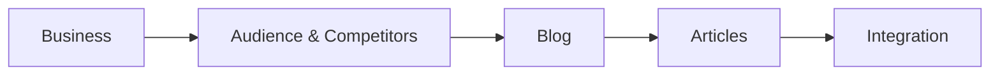

# Software Design

Lets digest the software flow first then jump to the design

This project is a dashboard design. But before landing to dashboard a new user should be landing to SETUP stage, after that it should be landing to the dashboard.

endpoint `/api/v0/core/status` returns `setup_complete` then go to dashboard, go to setup otherwise.

# Login & Subscribe

When user lands into landing page and clicks on login or subscribe he should be forwarded to google auth (or similar).

<aside>
💡

Using only google auth for login option is a good idea here in order to eliminate duplicate accounts.

</aside>

`POST: /api/v0/core/login` returns JWT.

`GET: /api/v0/core/organizations` should return the organizaitons the user currently have.

If no orgs are returned this is an indicator of a new/fresh user and he should be redirected to setup page.

# Setup Stage (New user onboarding)

## 1. Start

Identity is **server-owned**: the org id is the org's Mongo `_id` (exposed as a
string), per [data-layer.md](data-layer.md). The frontend does **not** mint an
`org_id` — it has none until `start_scan` creates the org and returns one, which
the FE then persists (e.g. localStorage) to poll `/status` and `/details`.

> _Resolved design tension:_ an earlier draft had the FE generate a random
> `org_id` up front. We keep server-generated ids (one identity, no client-chosen
> keys) and instead make `start_scan` **idempotent**: a retry for the same user +
> URL reuses the in-progress org rather than duplicating it (see §1 start_scan).

endpoint `/api/v0/setup/status` returns `setup_not_started` for any unknown
`org_id` (e.g. before the first scan).

Then we load the start scanning page.

**Mockup — Start (Enter URL):** A single-field landing screen headed "Let's start with **your website**!" with subtext "Share your website URL and we'll instantly gather your business information to save you time." One URL input (e.g. `https://ridersdiary.sparkie.space/`) with a **Continue** button. A validation hint appears if no URL is entered.

Enter your website URL

endpoint `/api/v0/setup/start_scan`

payload: website url string. (No `org_id` — the server creates the org and
returns its id.) Idempotent: if the user already has a non-`setup_complete` org
for this URL, that org is reused and re-armed instead of creating a new one.

this will trigger the website _scanner_worker_

enqueue task (aws sqs) which will trigger a lambda function (scanner worker)

This will also set status to `setup_scan_in_progress`

## 1.1 Scanner Worker

This will scan the website possibly scrape the data and make AI calls to generate the following presets:

- about your business details
  - business name
  - language
  - country
  - description
- Target audience & competitors
- Blog
  - sitemap url
  - main blog address
  - best article examples
- Article Preferences
  - Content & SEO
    - Article style
    - Internal links
    - Instructions for LLM
  - Engagement
    - Image style
  - And such..

All of the above are just presets, meaning user can edit and change them all. So all those forms should be behind an endpoint.

## 2. Scan Customer Website

**Mockup — Scan Website (in progress):** A loading screen with a "Scanning your website data…" spinner and an explainer card: "Let's tailor [product] to **your business**! Once we've analyzed your website, we'll guide you forward. A few important steps help us understand your business, your audience, and what great content should look like — we'll need about 5–10 minutes of your time."

scanner_worker in progress

endpoint `/api/v0/setup/status` returns `setup_scan_in_progress` .

## 3. User Input Overrides Setup Presets.

**Mockup — About your business (editable, pre-populated form):** Heading "About your business" with subtext "Based on your website, we've populated the following information, please verify and complete as needed." Fields, all pre-filled from the scan and editable:

- **Business name** (text) — e.g. `Clewas`
- **Language** (select) — e.g. `English`
- **Country** (select) — e.g. `Global (English)`, with hint "Uses US English search data as the broadest international signal."
- **Description** (rich-text) — AI-generated business summary
- **Platform and services** (continues below)

endpoint `/api/v0/setup/status` should return `setup_scan_completed`. This means setup worker is finished. And frontend can query `/api/v0/setup/details` endpoint.

`GET: /api/v0/setup/details`: returns everything (queryable) mentioned at the 1.1 making the whole setup process up until integrations a single endpoint and frontend work.

## 3.1 Integrations

This is a hard step, lets leave this for later.

**Mockup — Create Integrations:** The setup wizard is a 5-step stepper; integrations is the final step:

Heading "Create Integrations" with subtext "Connect your blog to publish articles automatically, or set this up later in your dashboard." A grid of selectable publishing-platform providers: WordPress, Notion, Webflow, Shopify, Wix, WordPress.com, API Webhook, Framer, Ghost, Next.js Blog (retrieve content through an NPM package), and Feather. This step is optional and can be deferred to the dashboard.

`GET: /api/v0/setup/integrations` Lists current Integrations

`POST: /api/v0/setup/integrations` Writes/makes Integrations

## 4. Finish Setup

Last step is finished

`POST: /api/v0/setup/finalize` will write to db.

Also sets `/api/v0/setup/status` return to `setup_complete.`

From this point forward our only concern is dashboard.

# Dashboard

**Mockup — Dashboard shell (reference: Outrank):** A left sidebar + main content layout. The sidebar groups navigation:

- **Home**
- **Articles** — Content Planner, Improvements (Beta), Content History, Articles Settings, Integrations, Linking Configuration
- **Backlink Exchange**, **Free Tools Builder**
- **Add-ons** — Human Curated Service, Get 350+ Backlinks
- Footer: referral program, upgrade prompt, account/plan info

The main area shown is the **Content Planner**: "Creating your content strategy — we're analyzing your website and competitors, selecting keywords by search volume and difficulty, and scheduling a month of articles into your planner," with an "Articles Plan: 30 per month" selector and a monthly calendar.

Outrank has many features that we wont support until much later so we can strip lots of stuff and focus on the necessary.

## Subscription Model

- Free
  - user behind the paywall, cant do anything expect update the parameters set in setup stage.
- Paid
  - User now has access to all the features
  - first feature is articles

promo-codes: promo codes can reduce the recurring monthly fee’s or can reduce the fee’s up to certain months.

<aside>
⚠️

Promo codes need to integrate into payment system, we need to look into that. So its better to design the system with promo codes.

</aside>

## 1. Home Page

If the following query returns something then we land into dashboard page.

`GET: /api/v0/core/organizations`

**Mockup — Home page:** Top bar shows the org domain (e.g. `Clewas / www.clewas.com`), a "share results" action, and a **Domain Rating** badge (via Ahrefs). Cards below:

- **Backlink Exchange** — disabled during free trial, with an Upgrade prompt.
- **Articles** — "Published" count and "Planned" count (both `0` for a fresh org), with "Visit content planner" / "Add keywords" links.
- **Recommended Actions** — next-step cards: "Connect a publishing integration", "Add keywords to start generating", "Connect Google Search Console".
- **Best Articles** — gated block: "Connect Google Search Console to unlock this block" (article performance becomes available once live Google data is connected).

- Shows number of articles published
- Shows Domain Authority/Domain Rating, Published Articles, Backlinks, Google clicks (via google search console integration)

`GET: /dashboard/v0/articles/best` returns best articles

`GET: /dashboard/v0/articles/published` returns int

`GET: /dashboard/v0/articles/planned` returns int

`GET: /dashboard/v0/integrations/connected` returns array of connected integrations

## 2. Articles

**Mockup — Articles sidebar submenu:** The expanded "Articles" navigation group lists: Content Planner, Improvements (Beta), Content History, Articles Settings, Integrations, Linking Configuration.

### 2.1 Content Planner

INC

### 2.2 Content History

INC

### 2.3 Articles Settings

INC

### 2.4 Integrations

INC
