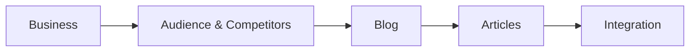

# Software Design

Lets digest the software flow first then jump to the design

This project is a dashboard design. But before landing to dashboard a new user should be landing to SETUP stage, after that it should be landing to the dashboard.

endpoint `/api/v0/core/status` returns `setup_complete` then go to dashboard, go to setup otherwise.

# Login & Subscribe

When user lands into landing page and clicks on login or subscribe he should be forwarded to google auth (or similar).

<aside>
💡

Using only google auth for login option is a good idea here in order to eliminate duplicate accounts.

</aside>

`POST: /api/v0/core/login` returns JWT.

`GET: /api/v0/core/organizations` should return the organizations the user currently have.

If no orgs are returned this is an indicator of a new/fresh user and he should be redirected to setup page.

# Setup Stage (New user onboarding)

## 1. Start

Identity is **server-owned**: the org id is the org's Mongo `_id` (exposed as a
string), per [data-layer.md](data-layer.md). The frontend does **not** mint an
`org_id` — it has none until `start_scan` creates the org and returns one, which
the FE then persists (e.g. localStorage) to poll `/status` and `/details`.

> _Resolved design tension:_ an earlier draft had the FE generate a random
> `org_id` up front. We keep server-generated ids (one identity, no client-chosen
> keys) and instead make `start_scan` **idempotent**: a retry for the same user +
> URL reuses the in-progress org rather than duplicating it (see §1 start_scan).

endpoint `/api/v0/setup/status` returns `setup_not_started` for any unknown
`org_id` (e.g. before the first scan).

Then we load the start scanning page.

**Mockup — Start (Enter URL):** A single-field landing screen headed "Let's start with **your website**!" with subtext "Share your website URL and we'll instantly gather your business information to save you time." One URL input (e.g. `https://ridersdiary.sparkie.space/`) with a **Continue** button. A validation hint appears if no URL is entered.

Enter your website URL

endpoint `/api/v0/setup/start_scan`

payload: website url string. (No `org_id` — the server creates the org and
returns its id.) Idempotent: if the user already has a non-`setup_complete` org
for this URL, that org is reused and re-armed instead of creating a new one.

this will trigger the website _scanner_worker_

enqueue task (aws sqs) which will trigger a lambda function (scanner worker)

This will also set status to `setup_scan_in_progress`

## 1.1 Scanner Worker

This will scan the website possibly scrape the data and make AI calls to generate the following presets:

- about your business details
  - business name
  - language
  - country
  - description
- Target audience & competitors
- Blog
  - sitemap url
  - main blog address
  - best article examples
- Article Preferences
  - Content & SEO
    - Article style
    - Internal links
    - Instructions for LLM
  - Engagement
    - Image style
  - And such..

All of the above are just presets, meaning user can edit and change them all. So all those forms should be behind an endpoint.

## 2. Scan Customer Website

**Mockup — Scan Website (in progress):** A loading screen with a "Scanning your website data…" spinner and an explainer card: "Let's tailor [product] to **your business**! Once we've analyzed your website, we'll guide you forward. A few important steps help us understand your business, your audience, and what great content should look like — we'll need about 5–10 minutes of your time."

scanner_worker in progress

endpoint `/api/v0/setup/status` returns `setup_scan_in_progress` .

## 3. User Input Overrides Setup Presets.

**Mockup — About your business (editable, pre-populated form):** Heading "About your business" with subtext "Based on your website, we've populated the following information, please verify and complete as needed." Fields, all pre-filled from the scan and editable:

- **Business name** (text) — e.g. `Clewas`
- **Language** (select) — e.g. `English`
- **Country** (select) — e.g. `Global (English)`, with hint "Uses US English search data as the broadest international signal."
- **Description** (rich-text) — AI-generated business summary
- **Platform and services** (continues below)

endpoint `/api/v0/setup/status` should return `setup_scan_completed`. This means setup worker is finished. And frontend can query `/api/v0/setup/details` endpoint.

`GET: /api/v0/setup/details`: returns everything (queryable) mentioned at the 1.1 making the whole setup process up until integrations a single endpoint and frontend work.

## 3.1 Integrations

This is a hard step, lets leave this for later.

**Mockup — Create Integrations:** The setup wizard is a 5-step stepper; integrations is the final step:

Heading "Create Integrations" with subtext "Connect your blog to publish articles automatically, or set this up later in your dashboard." A grid of selectable publishing-platform providers: WordPress, Notion, Webflow, Shopify, Wix, WordPress.com, API Webhook, Framer, Ghost, Next.js Blog (retrieve content through an NPM package), and Feather. This step is optional and can be deferred to the dashboard.

`GET: /api/v0/setup/integrations` Lists current Integrations

`POST: /api/v0/setup/integrations` Writes/makes Integrations

## 4. Finish Setup

Last step is finished

`POST: /api/v0/setup/finalize` will write to db.

Also sets `/api/v0/setup/status` return to `setup_complete.`

From this point forward our only concern is dashboard.

# Dashboard

**Mockup — Dashboard shell (reference: Outrank):** A left sidebar + main content layout. The sidebar groups navigation:

- **Home**
- **Articles** — Content Planner, Improvements (Beta), Content History, Articles Settings, Integrations, Linking Configuration
- **Backlink Exchange**, **Free Tools Builder**
- **Add-ons** — Human Curated Service, Get 350+ Backlinks
- Footer: referral program, upgrade prompt, account/plan info

The main area shown is the **Content Planner**: "Creating your content strategy — we're analyzing your website and competitors, selecting keywords by search volume and difficulty, and scheduling a month of articles into your planner," with an "Articles Plan: 30 per month" selector and a monthly calendar.

Outrank has many features that we wont support until much later so we can strip lots of stuff and focus on the necessary.

## 0. Reference architecture (Outrank observations)

Captured by inspecting the live outrank.so dashboard network traffic on 2026-07-01.
These are **reference notes**, not our design — ours stays a curated Hono API.

**Two API layers (theirs):**

1. `api.outrank.so/rest/v1/<table>` — **Supabase / PostgREST**. The client reads DB
   tables directly (row-level `GET`/`POST`/`PATCH`/`DELETE`, `HEAD` for counts via
   content-range). Tables seen: `organizations`, `users`, `products`, `competitors`,
   `articles`, `scheduled_keywords`, `keywords_storage`, `output_settings_presets`,
   `custom_image_presets`, `search_console_connections`, `domain_rating_history`,
   `backlink_credits`, `backlink_usage`, `seo_tools*`, and various `*_subscriptions`.
2. `www.outrank.so/api/*` — **Next.js BFF** for computed / third-party-backed data:
   `/api/subscription/status`, `/api/domain-rating`, `/api/backlinks/{count,credits}`,
   `/api/seo-tools/usage`, `/api/products/improvement-settings`, `/api/catalog/profile`,
   `/api/user/update-tracking`.

**Tenancy hierarchy (theirs):** `Organization → Product → {articles, keywords, …}`.
Every request is keyed by both `organization_id` and `product_id`. A **product = one
website**; multiple products live under one org (multi-site plans + volume discounts).

> **Divergence from ours:** our model treats an **Org as the website** (`OrgSchema`
> carries `website_url`). Outrank splits **billing tenant (org)** from **site (product)**.
> For our baseline (one site per org) this is fine; if multi-site lands, we'd introduce a
> `Product`/`Site` entity under `Org`. Recorded in
> [`onboarding-parity-gaps.md`](onboarding-parity-gaps.md) territory (deferred).

## Subscription Model

- Free
  - user behind the paywall, cant do anything except update the parameters set in setup stage.
- Paid
  - User now has access to all the features
  - first feature is articles

promo-codes: promo codes can reduce the recurring monthly fee’s or can reduce the fee’s up to certain months.

<aside>
⚠️

Promo codes need to integrate into payment system, we need to look into that. So its better to design the system with promo codes.

</aside>

### Subscription gate design (baseline)

Observed on Outrank: subscription state is read from `GET /api/subscription/status?
organizationId=…&productId=…` (and backing `*_subscriptions` tables). A **trial** org can
finish onboarding and edit settings, but the content engine is inert — the planner renders
empty with a "Trial accounts… Upgrade to unlock" banner and disabled actions (see §2.1).

We mirror that contract without copying their table sprawl:

**Subscription state.** Store on the org: `subscription_status` ∈
`{ none, trialing, active, past_due, canceled }` + `current_period_end`. Treat
`active` (and optionally `trialing` if we offer trials) as **entitled**; everything else
is **free/locked**. Source of truth is the payment provider (Stripe) via webhook →
`OrgRepo.updateSubscription`; the API never trusts the client.

**What each tier can do:**

| Capability | Free / locked | Entitled (paid) |
| --- | --- | --- |
| View dashboard, Home cards, planner shell | ✅ | ✅ |
| Edit setup presets / article settings (`PATCH /setup/presets`, `/dashboard/v0/settings/*`) | ✅ | ✅ |
| Keyword research (`POST /dashboard/v0/keywords/research`) | ⛔ paywall | ✅ |
| Article generation / publish workers | ⛔ paywall | ✅ |
| Integrations connect, Backlink Exchange, GSC | ⛔ (deferred anyway) | ✅ later |

**Enforcement.** A small `requirePaid` middleware (composes with `authMiddleware`) checks
the caller's org `subscription_status`. Gated endpoints return **HTTP 402 Payment Required**
with a typed body `{ error: 'subscription_required', upgrade_url }` so the FE renders the
same "Upgrade to unlock" surface consistently. Read/settings endpoints skip the gate.

**Promo codes.** Model as provider-side coupons (Stripe) applied at checkout — they change
*billing amount*, not entitlement logic. Our gate only ever asks "is the subscription
`active`?", so a 100%-off promo yields a normal `active` subscription and Just Works; no
special-casing in the API. Keep promo handling entirely in the checkout/webhook layer.

**Deferred:** proration/plan-tier changes (8/30/60 articles/month), add-ons
(`article_addon_subscriptions`, premium images, SEO tools), and multi-product volume
discounts — all out of baseline.

## 1. Home Page

If the following query returns something then we land into dashboard page.

`GET: /api/v0/core/organizations`

**Mockup — Home page:** Top bar shows the org domain (e.g. `Clewas / www.clewas.com`), a "share results" action, and a **Domain Rating** badge (via Ahrefs). Cards below:

- **Backlink Exchange** — disabled during free trial, with an Upgrade prompt.
- **Articles** — "Published" count and "Planned" count (both `0` for a fresh org), with "Visit content planner" / "Add keywords" links.
- **Recommended Actions** — next-step cards: "Connect a publishing integration", "Add keywords to start generating", "Connect Google Search Console".
- **Best Articles** — gated block: "Connect Google Search Console to unlock this block" (article performance becomes available once live Google data is connected).

- Shows number of articles published
- Shows Domain Authority/Domain Rating, Published Articles, Backlinks, Google clicks (via google search console integration)

`GET: /dashboard/v0/articles/best` returns best articles

`GET: /dashboard/v0/articles/published` returns int

`GET: /dashboard/v0/articles/planned` returns int

`GET: /dashboard/v0/integrations/connected` returns array of connected integrations

**Observed on Outrank Home (maps to the cards above):** article counts come from
`HEAD articles?status=eq.published` / `…status=neq.deleted` (count via content-range) and
planned = count of `scheduled_keywords`; Domain Rating via `/api/domain-rating` (+
`domain_rating_history` table); backlinks via `/api/backlinks/{count,credits}`; GSC gate via
`search_console_connections`; best articles via `articles?select=title,slug&status=published`.
Our four endpoints above cover the baseline; **defer** domain-rating/backlinks/GSC cards
(they need Ahrefs + Google Search Console integrations — see parity-gaps G7).

## 2. Articles

**Mockup — Articles sidebar submenu:** The expanded "Articles" navigation group lists: Content Planner, Improvements (Beta), Content History, Articles Settings, Integrations, Linking Configuration.

### 2.1 Content Planner

The default dashboard landing (`/dashboard/scheduler`). A **monthly calendar** where each
day holds at most one **keyword** (an article opportunity). Heading: "These are keyword
opportunities scheduled for your site. Outrank will try to create one article for each
keyword to help you rank."

**Behaviour observed:**

- On finish of onboarding, a background job builds the plan ("Creating your content
  strategy — analyzing your website and competitors, selecting keywords by search volume
  and difficulty, and scheduling a month of articles"). Takes ~8–10 min.
- **Plan tier** selector ("Articles Plan: 30 per month") drives cadence: e.g. 8/mo = 2
  chosen weekdays, 30/mo ≈ 1/day, 60/mo = 2/day. Changing tier is paid-only.
- Articles are **generated & auto-published 7AM–9AM UTC** on their scheduled day.
- Empty day cells offer **"research keywords with AI"** (generate) or **drag & drop**
  to reorder. Per-keyword custom instructions via a lightbulb icon.
- **Capacity / auto top-up:** max 60 keywords scheduled at once; the queue auto-refills to
  keep 25–30 (1/day) · 50–60 (2/day) · 75–90 (3/day) so content never runs dry.
- Trial gates: "Research Keywords" / "Schedule Improvements" disabled until paid.

**Reference endpoints (theirs):** `GET scheduled_keywords?product_id=…&status=neq.disabled&
order=utc_scheduled_date.asc,search_volume.desc` (the calendar), `HEAD scheduled_keywords`
(count), `keywords_storage` (the pool), `output_settings_presets` (gen prefs).

**Our baseline design:**

- `GET: /dashboard/v0/planner` — scheduled keywords for the org's active site, each
  `{ id, keyword, status, scheduled_date, search_volume }`, ordered by date.
- `POST: /dashboard/v0/keywords/research` — enqueue AI keyword generation (async, SQS —
  same pattern as the scanner worker); refills the queue toward the plan minimum.
- `PATCH: /dashboard/v0/keywords/:id` — reschedule (drag/drop) or attach custom
  instructions.
- Article generation itself (keyword → published article) is a **later** worker; baseline
  can stop at "keywords scheduled".

**Observed trial gating (2026-07-01, Sparkie trial):** after onboarding, the "Creating your
content strategy" banner ran and then cleared, but the planner stayed **empty (0 scheduled
keywords)** with "Research Keywords" / "Schedule Improvements" **disabled** and a "Trial
accounts don't participate… Upgrade to unlock" banner. I.e. on a free/trial plan the planner
does **not** populate — keyword generation is paywalled. This matches the Subscription Model
above (Free = behind paywall, can only edit setup parameters). Baseline implication: gate
`POST /keywords/research` and any generation behind an active paid subscription.

### 2.2 Content History

The library of generated/published articles (`/dashboard/articles`). Each article moves
through a status lifecycle: `generated → published` (plus `deleted`, and a `publish_error`
flag when a CMS push fails). Counts on Home come from `HEAD` queries against this table.

**Reference endpoints (theirs):** `HEAD articles?status=not.eq.deleted` (total),
`articles?select=title,slug&status=eq.published` (list). Article rows carry
`{ id, title, slug, status, published_at, created_at, publish_error }`.

**Our baseline design:**

- `GET: /dashboard/v0/articles` — paginated list for the active site, filterable by status,
  ordered by `created_at desc`.
- `GET: /dashboard/v0/articles/:id` — single article (body/content).
- Article **generation** (keyword → article) and **publish** (article → CMS) are later
  workers; baseline can surface an empty/placeholder history until generation lands.

### 2.3 Articles Settings

A settings section with three sub-tabs: **Preferences · Blog · Improvements**
(`/dashboard/settings/articles/*`). This is the post-onboarding home of the same data the
setup wizard collected — i.e. the presets become **editable settings** after `setup_complete`.

- **Preferences** ← `output_settings_presets` (GET/PATCH) = our `article_preferences`
  (`content_seo` + `engagement`). Baseline reuses `PATCH /setup/presets` shape or a
  dashboard-scoped `PATCH /dashboard/v0/settings/articles`.
- **Blog** ← the `blog` presets (sitemap, main blog, best articles).
- **Improvements** ← `/api/products/improvement-settings` + `custom_image_presets` +
  `/api/catalog/profile`. These are the **deferred** subsystems (parity-gaps G2): article
  Improvement Schedule, custom AI image presets, Product Catalog. **Out of baseline.**

**Our baseline design:**

- `GET: /dashboard/v0/settings/articles` — current article preferences for the site.
- `PATCH: /dashboard/v0/settings/articles` — edit them (same deep-merge as
  `/setup/presets`).

### 2.4 Integrations

Manage publishing connections (`/dashboard/integrations`, add via
`/dashboard/integrations/new`). This is the post-setup home of the deferred **Integration**
onboarding step (parity-gaps G1). Outrank routes this through its BFF, not direct tables.

**Reference endpoints (theirs):** `GET /api/integrations?product_id=…` (connected list);
connect/disconnect flow through the BFF + provider OAuth.

**Our baseline design (deferred — matches `⬜ /setup/integrations` in PROGRESS):**

- `GET: /dashboard/v0/integrations` — connected publishing targets for the site.
- `POST: /dashboard/v0/integrations` — connect a provider (OAuth/credentials).
- `DELETE: /dashboard/v0/integrations/:id` — disconnect.
- Deferred because per-provider auth/token storage is the hard part; no baseline need.

### 2.5 Linking Configuration

Internal-linking rules (`/dashboard/linking`) — how new articles link to existing pages,
gated on a sitemap being present (ties to `blog.sitemap_url` and the internal-links pref).
Baseline: fold into Articles Settings; a dedicated surface is **deferred**.
